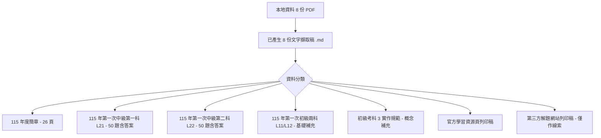
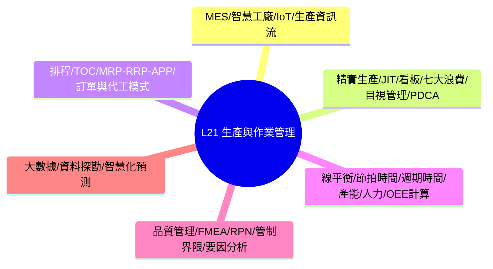
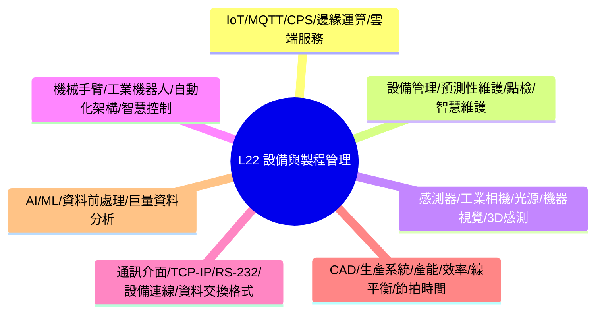
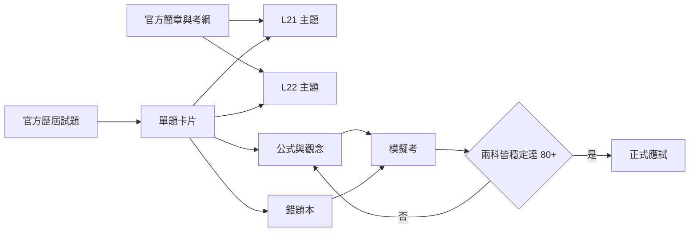
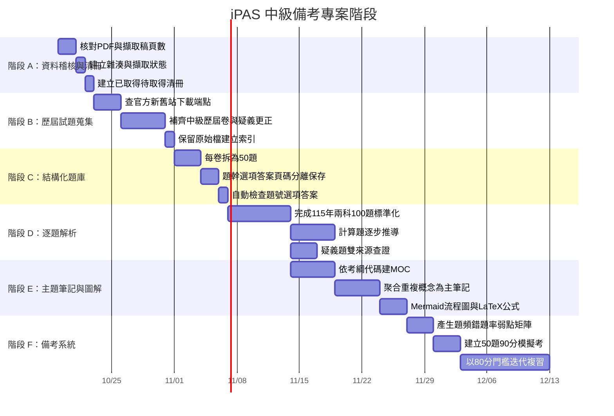
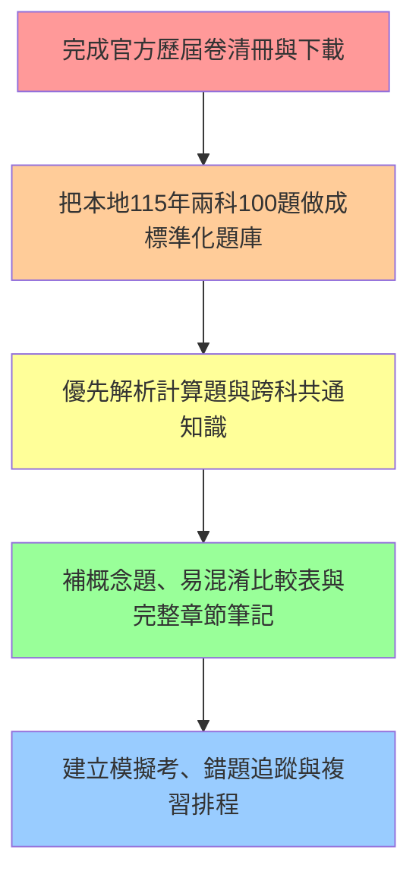
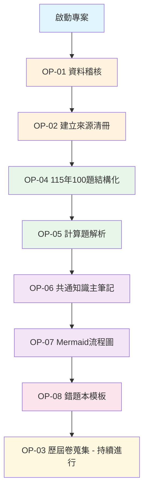
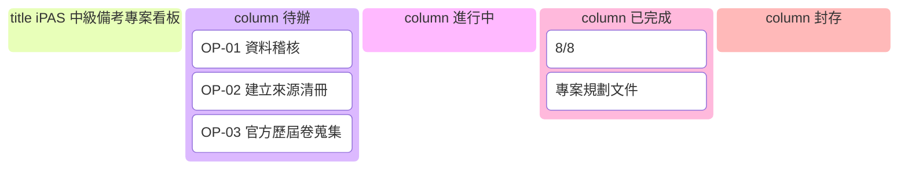

# iPAS 智慧生產工程師（中級）備考專案啟動紀錄

> 專案路徑：`D:\80-Opnecode\Projects\2026-11-14-iPAS-IME`
> 記錄日期：2026-10-19

---

## 1. 專案概況

### 1.1 專案目標
將官方簡章、歷屆試題與可靠解題依據整理成可在 Obsidian 搜尋、連結、複習與追蹤錯題的知識庫，最終協助通過中級兩科並取得證書。

### 1.2 目前資料盤點



| 類型 | 數量 | 頁數/題數 | 判斷 |
|---|---:|---|---|
| 115 年度簡章 | 1 份 | 26 頁 | ✅ 已成功擷取文字層 |
| 115 年第一次中級第一科 (L21) | 1 份 | 50 題 | ✅ 已成功擷取，含公告答案 |
| 115 年第一次中級第二科 (L22) | 1 份 | 50 題 | ✅ 已成功擷取，含公告答案 |
| 115 年第一次初級兩科 (L11/L12) | 2 份 | 各 50 題 | ✅ 可作補充基礎題庫 |
| 初級考科 3 實作規範 | 1 份 | - | ✅ 僅作概念補充 |
| 官方學習資源頁列印稿 | 1 份 | - | ✅ 顯示官方僅列出 115 年試題 |
| 第三方解題網站列印稿 | 1 份 | - | ⚠️ 僅作線索，不可取代官方答案 |

> **關鍵結論**：目前本地只有 **115 年第一次中級 100 題**，尚不能稱為「歷屆所有試題」。

---

## 2. 考試規則摘要 (依 115 年度簡章)

| 項目 | 第一科 (L21) | 第二科 (L22) |
|---|---|---|
| 正式名稱 | 智慧製造生產與作業管理之實務應用 | 智慧製造之設備與製程管理之實務應用 |
| 代碼 | L21 | L22 |
| 題型 | 單選題 100% | 單選題 100% |
| 題數 | 50 題 | 50 題 |
| 時間 | 90 分鐘 | 90 分鐘 |
| 鑑定方式 | 電腦測驗 | 電腦測驗 |

**及格標準**：
- 同時報考兩科：總平均 ≥ 70 分且**每科不得低於 60 分**
- 單科報考：各科均須達 70 分
- 單科達 70 分後，成績自應考日起保留三年度
- 中級證書有效期 5 年，換證需符合訓練時數規定

> **備考安全目標**：不以剛好 70 分為目標。題庫練習應達到兩科各 **80 分以上**，且跨年度模擬考連續三回達標。

---

## 3. 兩科主題分析

### 3.1 第一科 L21：生產與作業管理


**高投報率計算題公式**：

| 公式 | 說明 |
|---|---|
| `Line Balance Rate = (Σ t_i) / (N × C_max) × 100%` | 線平衡率 |
| `OEE = Availability × Performance × Quality` | 整體設備效率 |
| `Takt Time = Available Production Time / Customer Demand` | 節拍時間 |

### 3.2 第二科 L22：設備與製程管理


### 3.3 兩科重疊區
```mermaid
venn
    title 兩科重疊知識區
    L21 : 智慧工廠
    L21 : MES
    L21 : IoT
    L21 : 產能計算
    L21 : 線平衡
    L21 : 資料分析
    L22 : 智慧工廠
    L22 : MES
    L22 : IoT
    L22 : 產能計算
    L22 : 線平衡
    L22 : 資料分析
```
> **策略**：共通知識只建一份主筆記，再由各科題目反向連結，避免內容重複與版本不一致。

---

## 4. 來源可信度分級

| 等級 | 來源 | 用法 |
|---|---|---|
| **A** | iPAS 官方公告試題、簡章、疑義更正 | 題幹與答案的最終依據 |
| **B** | 官方參考書、標準、設備原廠文件、學術教材 | 解釋原理、公式與名詞 |
| **C** | 大學課程、可信培訓教材 | 補充教學與例題 |
| **D** | 第三方題庫、老師解答、論壇文章 | 僅作查漏與線索，必須交叉核對 |

> 每題必須記錄 `source`、`answer_source` 與 `verified`。第三方答案若與官方公告不同，保留差異紀錄，但以官方公告作答。

---

## 5. 建議 Obsidian Vault 結構

```text
2026-11-14-iPAS-IME/
├─ 00-首頁.md
├─ 00-專案規劃.md
├─ 01-原始資料/
│  ├─ 官方PDF/
│  ├─ 網頁存證/
│  └─ 來源清冊.md
├─ 02-原始擷取/
│  ├─ PDF全文/
│  └─ OCR稽核/
├─ 03-歷屆試題/
│  ├─ 115-第一次-L21/
│  ├─ 115-第一次-L22/
│  └─ 題庫總表.md
├─ 04-科目筆記/
│  ├─ L21-生產與作業管理/
│  ├─ L22-設備與製程管理/
│  └─ 共通知識/
├─ 05-公式與圖解/
│  ├─ 公式總表.md
│  ├─ Mermaid流程圖.md
│  └─ 易混淆比較表.md
├─ 06-錯題本/
│  ├─ L21-錯題.md
│  └─ L22-錯題.md
├─ 07-模擬考/
├─ 08-來源與勘誤/
└─ attachments/
```

---

## 6. 知識圖譜流程



---

## 7. 執行階段規劃



---

## 8. 驗收標準

| 條目 | 標準 |
|---|---|
| 來源可追溯 | 每份來源都有出處、頁數、雜湊與擷取狀態 |
| 題目完整 | 每份正式卷題號 1–50 完整，四選項與官方答案齊全 |
| 可回溯原檔 | 每題可回溯至原 PDF 頁碼或題目截圖 |
| 公式渲染 | 所有計算式可在 Obsidian 正常顯示 |
| 圖表渲染 | 所有 Mermaid 圖可正常渲染，節點名稱不失真 |
| 答案正確 | 題庫中的官方答案與原卷逐題比對一致 |
| 不覆蓋官方 | 非官方解答不會覆蓋官方答案 |
| 標記異常 | 缺卷、疑義題與未驗證內容都有醒目標記 |

---

## 9. 建議工作優先順序



---

## 10. 可執行的操作項目

根據目前專案狀態，可進行的操作：

| 代號 | 操作項目 | 說明 | 預估工時 |
|---|---|---|---|
| **OP-01** | **資料稽核** | 核對 8 份 PDF 與對應 .md 擷取稿的頁數、字數、完整度 | 1-2 小時 |
| **OP-02** | **建立來源清冊** | 為每份來源建立 SHA-256 雜湊、頁數、文字層/OCR 狀態、下載日期 | 30 分鐘 |
| **OP-03** | **官方歷屆卷蒐集** | 查詢 iPAS 官網、舊站、Web Archive 取得更多中級歷屆試題 | 2-4 小時 |
| **OP-04** | **115 年兩科 100 題結構化** | 將 L21、L22 各 50 題拆解為標準化單題卡片 | 3-4 小時 |
| **OP-05** | **計算題逐步解析** | 針對線平衡、OEE、節拍時間、產能等計算題建立完整推導 | 2-3 小時 |
| **OP-06** | **共通知識主筆記建立** | 智慧工廠、MES、IoT、線平衡、資料分析等重疊主題整合 | 2-3 小時 |
| **OP-07** | **Mermaid 流程圖繪製** | 針對 MES 架構、生產流程、維護決策樹等繪製流程圖 | 2-3 小時 |
| **OP-08** | **錯題本模板建立** | 建立 L21/L22 錯題追蹤模板，含標籤、錯因、複習間隔 | 1 小時 |

---

## 11. 下一步行動建議



**建議先從 OP-01、OP-02 開始**，確保手邊資料品質無誤，再進行 OP-04 的題庫結構化工作。

---

## 12. 環境與工具確認

| 項目 | 狀態 | 備註 |
|---|---|---|
| Obsidian | 需安裝/確認 | 建議直接用 `Open folder as vault` 開啟專案資料夾 |
| Mermaid 渲染 | ✅ 原生支援 | Obsidian 內建 |
| LaTeX 數學式 | ✅ 原生支援 | 行內 `$...$`、區塊 `$$...$$` |
| PDF 文字擷取 | ✅ 已完成 8 份 | 位於 `01-原始擷取/` |
| Git 版控 | ❌ 尚未初始化 | 建議 `git init` 後再推送 GitHub |

---

## 13. 待辦事項追蹤



---

*本紀錄依 AGENTS.md 規範產出，採用 Markdown + Mermaid 格式，置於專案資料夾下。*