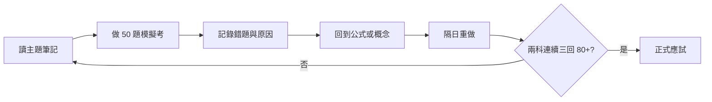

# iPAS 智慧生產工程師中級備考首頁

> [!goal] 考試目標
> L21 與 L22 模擬考各自穩定達 80 分以上，並能說明計算題公式、設備／系統層級與易混淆名詞。

## 快速入口

- [[00-專案規劃|專案規劃]]
- [[04-科目筆記/L21-生產與作業管理/00-L21-MOC|L21 生產與作業管理]]
- [[04-科目筆記/L22-設備與製程管理/00-L22-MOC|L22 設備與製程管理]]
- [[04-科目筆記/共通知識/智慧工廠系統架構|共通知識：智慧工廠系統架構]]
- [[05-公式與圖解/公式總表|公式總表]]
- [[05-公式與圖解/易混淆比較表|易混淆比較表]]
- [[05-公式與圖解/Mermaid-考綱知識圖|考綱知識圖]]
- [[03-歷屆試題/115-第一次-L21/00-題目索引|115 L21 題目索引]]
- [[03-歷屆試題/115-第一次-L22/00-題目索引|115 L22 題目索引]]
- [[08-來源與勘誤/階段D-逐題解析驗證|解析驗證與疑義題]]

## 備考循環

## 目前資料狀態

| 項目 | 狀態 |
|---|---|
| 官方中級試題 | 115 年第一次 L21、L22 已收錄 |
| 題庫 | 100 題，均有官方答案與來源頁 |
| 詳解 | 100 題已有第一版；13 題具完整計算 |
| 疑義 | L21 Q28 的 OEE 公告答案與標準推導不一致 |
| 舊年度官方卷 | 108～114 目前未在官方學習資源頁公開 |

