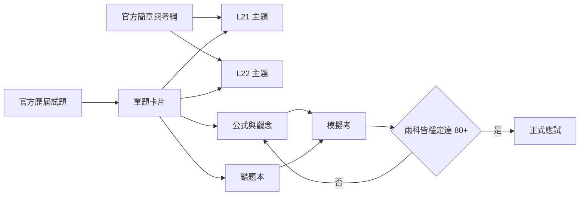

# iPAS 智慧生產工程師（中級）備考知識庫規劃

> [!summary] 目標
> 將官方簡章、歷屆試題與可靠解題依據整理成可在 Obsidian 搜尋、連結、複習與追蹤錯題的知識庫，最終協助通過中級兩科並取得證書。

## 1. 本地資料盤點與初讀結論

指定的 `D:\80-Opnecode\Projects\2026-11-14-iPAS` 不存在；實際資料位於：

`D:\80-Opnecode\Projects\2026-11-14-iPAS-IME`

目前有 8 份 PDF，且已產生 8 份文字擷取稿：

| 類型 | 現況 | 判斷 |
|---|---:|---|
| 115 年度簡章 | 1 份，26 頁 | 已成功擷取文字層 |
| 115 年第一次中級第一科 | 1 份，50 題 | 已成功擷取，PDF 內含公告答案 |
| 115 年第一次中級第二科 | 1 份，50 題 | 已成功擷取，PDF 內含公告答案 |
| 115 年第一次初級兩科 | 2 份 | 可作補充基礎題庫，不可混入中級成績統計 |
| 初級考科 3 實作規範 | 1 份 | 與目前中級兩科非直接應試範圍，僅作概念補充 |
| 官方學習資源頁列印稿 | 1 份 | 顯示目前官方頁只列出本地已有的 115 年試題 |
| 第三方解題網站列印稿 | 1 份 | 可作線索，不可取代官方答案或權威教材 |

目前本地只有 **115 年第一次中級 100 題**，尚不能稱為「歷屆所有試題」。

## 2. 考試規則（依 115 年度簡章）

| 項目 | 第一科 | 第二科 |
|---|---|---|
| 正式名稱 | 智慧製造生產與作業管理之實務應用 | 智慧製造之設備與製程管理之實務應用 |
| 代碼 | L21 | L22 |
| 題型 | 單選題 100% | 單選題 100% |
| 題數 | 50 題 | 50 題 |
| 時間 | 90 分鐘 | 90 分鐘 |
| 鑑定方式 | 電腦測驗 | 電腦測驗 |

同時報考兩科時，總平均須達 70 分且每科不得低於 60 分；若非同時報考，兩科均須各達 70 分。單科達 70 分後，成績自應考日起保留三年度。中級證書有效期 5 年，換證時須符合訓練時數規定。

> [!important] 備考安全目標
> 不以剛好 70 分為目標。題庫練習應達到兩科各 80 分以上，且跨年度模擬考連續三回達標。

## 3. 兩科初步題型分析

### 第一科：L21 生產與作業管理

初讀 115 年 50 題後，可分成下列主軸：

1. MES、智慧工廠、IoT 與生產資訊流。
2. 精實生產、JIT、看板、七大浪費、目視管理與 PDCA。
3. 排程、TOC、MRP／RRP／APP、訂單與代工模式。
4. 線平衡、節拍時間、週期時間、產能、人力與 OEE 計算。
5. 品質管理、FMEA、RPN、管制界限與要因分析。
6. 大數據、資料探勘與智慧化預測。

高投報率計算題：

$$
\text{Line Balance Rate} = \frac{\sum t_i}{N \times C_{\max}} \times 100\%
$$

$$
\text{OEE} = \text{Availability} \times \text{Performance} \times \text{Quality}
$$

$$
\text{Takt Time} = \frac{\text{Available Production Time}}{\text{Customer Demand}}
$$

### 第二科：L22 設備與製程管理

初讀 115 年 50 題後，可分成下列主軸：

1. IoT、MQTT、CPS、邊緣運算與雲端服務。
2. 設備管理、反應性／預防性／預測性維護、點檢與智慧維護。
3. 感測器、工業相機、光源、機器視覺與 3D 感測。
4. 機械手臂、工業機器人、自動化架構與智慧控制。
5. 通訊介面、TCP/IP、RS-232、設備連線與資料交換格式。
6. CAD、生產系統、產能、效率、線平衡與節拍時間。
7. AI／ML、資料前處理與巨量資料分析。

兩科有明顯重疊區：智慧工廠、MES、IoT、產能、線平衡與資料分析。共通知識應只建一份主筆記，再由各科題目反向連結，避免內容重複與版本不一致。

## 4. 來源可信度分級

| 等級 | 來源 | 用法 |
|---|---|---|
| A | iPAS 官方公告試題、簡章、疑義更正 | 題幹與答案的最終依據 |
| B | 官方參考書、標準、設備原廠文件、學術教材 | 解釋原理、公式與名詞 |
| C | 大學課程、可信培訓教材 | 補充教學與例題 |
| D | 第三方題庫、老師解答、論壇文章 | 僅作查漏與線索，必須交叉核對 |

每題必須記錄 `source`、`answer_source` 與 `verified`。第三方答案若與官方公告不同，保留差異紀錄，但以官方公告作答；若題目本身疑似有瑕疵，另建「疑義題」註記。

## 5. 建議 Obsidian Vault 結構

```text
2026-11-14-iPAS-IME/
├─ 00-首頁.md
├─ 00-專案規劃.md
├─ 01-原始資料/
│  ├─ 官方PDF/
│  ├─ 網頁存證/
│  └─ 來源清冊.md
├─ 02-原始擷取/
│  ├─ PDF全文/
│  └─ OCR稽核/
├─ 03-歷屆試題/
│  ├─ 115-第一次-L21/
│  ├─ 115-第一次-L22/
│  └─ 題庫總表.md
├─ 04-科目筆記/
│  ├─ L21-生產與作業管理/
│  ├─ L22-設備與製程管理/
│  └─ 共通知識/
├─ 05-公式與圖解/
│  ├─ 公式總表.md
│  ├─ Mermaid流程圖.md
│  └─ 易混淆比較表.md
├─ 06-錯題本/
│  ├─ L21-錯題.md
│  └─ L22-錯題.md
├─ 07-模擬考/
├─ 08-來源與勘誤/
└─ attachments/
```

### 建議開啟方式

直接用 Obsidian 的 **Open folder as vault（開啟資料夾作為知識庫）**，選擇：

`D:\80-Opnecode\Projects\2026-11-14-iPAS-IME`

Obsidian 原生即可顯示 Markdown、Mermaid 與行內／區塊 LaTeX。初期不依賴外掛，先確保任何電腦都能開啟；題庫成熟後再選擇性加入 Dataview、Tasks、Spaced Repetition。

## 6. 知識圖譜設計



## 7. 單題筆記標準

每題建立一份可獨立連結的 Markdown：

```yaml
---
id: 115-1-L21-Q01
year: 115
session: 1
subject: L21
question_no: 1
topic:
  - 智慧製造
difficulty: 1
official_answer: A
answer_source: 官方公告試題
verified: true
status: reviewed
---
```

正文固定包含：

1. 完整題幹與四個選項。
2. 官方答案。
3. 一句話判斷關鍵。
4. 正確選項詳解。
5. 其餘選項逐項辨析。
6. 對應考綱代碼。
7. 延伸觀念、公式或 Mermaid 圖。
8. 來源與頁碼。
9. 易錯原因與記憶口訣。

計算題再增加「已知、求解、公式、代入、單位檢查、答案核對」。

## 8. 歷屆試題蒐集策略

1. 先以 iPAS 官方「學習資源／歷屆試題」為主來源，保存原始 PDF、下載網址、下載日期、SHA-256 與公告狀態。
2. 盤點官方目前公開、已下架及只有搜尋引擎索引的年度。
3. 官方頁未列出的舊卷，再查官方舊站下載網址、網頁存檔與學校／培訓機構鏡像。
4. 第三方題庫僅用來找缺漏年份；取得後必須回查官方或可驗證的原始 PDF。
5. 每一份卷先確認級別、科目、年份、梯次、題數、答案欄與疑義更正，再匯入題庫。
6. 不把初級題目混成中級歷屆卷；可另建「基礎補強題庫」。

> [!warning] 「所有歷屆」的定義
> 以「目前能從官方或可驗證存檔取得的所有公開中級試題」為完成標準。若某年度從未舉辦中級、官方未公開，或檔案已下架且無可信存檔，會在缺卷清冊中明確標示，不以猜測題目補齊。

## 9. 執行階段

### 階段 A：資料稽核與清冊

- 核對 8 份 PDF 與擷取稿頁數。
- 為每份來源建立雜湊、頁數、文字層／OCR 狀態。
- 建立「已取得、待取得、不可驗證」清冊。

### 階段 B：歷屆試題蒐集

- 查官方新舊站與公開下載端點。
- 補齊可取得的中級 L21、L22 歷屆卷及疑義更正。
- 保留原始檔，不改名覆蓋；用索引提供人類可讀名稱。

### 階段 C：結構化題庫

- 每卷拆為 50 題。
- 題幹、選項、答案、頁碼與圖片分離保存。
- 自動檢查題號連續、選項完整、答案有效。

### 階段 D：逐題解析

- 先完成官方答案可直接核對的 115 年兩科 100 題。
- 計算題逐步推導；概念題逐項排除。
- 對疑義題進行雙來源以上查證。

### 階段 E：主題筆記與圖解

- 依 L211、L212、L221、L222、L223 建 MOC（Map of Content）。
- 將重複出題的概念聚合為單一主筆記。
- 用 Mermaid 表示流程、層級與系統關係；用 LaTeX 保存公式。

### 階段 F：備考系統

- 產生兩科題頻、錯題率與弱點矩陣。
- 建立 50 題／90 分鐘模擬考。
- 以 80 分為穩定門檻，針對弱項迭代複習。

## 10. 驗收標準

- 每份來源都有出處、頁數、雜湊與擷取狀態。
- 每份正式卷題號 1–50 完整，四選項與官方答案齊全。
- 每題可回溯至原 PDF 頁碼或題目截圖。
- 所有計算式可在 Obsidian 正常顯示。
- 所有 Mermaid 圖可正常渲染，節點名稱不失真。
- 題庫中的官方答案與原卷逐題比對一致。
- 非官方解答不會覆蓋官方答案。
- 缺卷、疑義題與未驗證內容都有醒目標記。

## 11. 建議工作優先順序

1. 完成官方歷屆卷清冊與下載。
2. 先把本地 115 年兩科 100 題做成標準化題庫。
3. 優先解析計算題與跨科共通知識。
4. 再補概念題、易混淆比較表與完整章節筆記。
5. 最後建立模擬考、錯題追蹤與複習排程。

## 12. 執行進度（2026-10-19）

| 階段 | 成果 | 驗證 |
|---|---|---|
| A 資料稽核 | 8 份 PDF、78 頁、SHA-256 清冊 | PASS |
| B 歷屆蒐集 | 官方目前公開的 115 年 L21、L22 已完整收錄；108～114 缺卷已登記 | PASS with gaps |
| C 結構化題庫 | 兩科各 50 題，共 100 份 Obsidian 題卡 | PASS |
| D 逐題解析 | 100 題第一版解析，13 題計算詳解 | PASS with 1 review item |
| E 主題筆記 | 兩科 MOC、系統架構、公式、比較表、考綱圖 | PASS |
| F 備考系統 | 兩科模擬考、答案卷、錯題本、四週儀表板 | PASS |

詳細證據均位於 `08-來源與勘誤/`。
