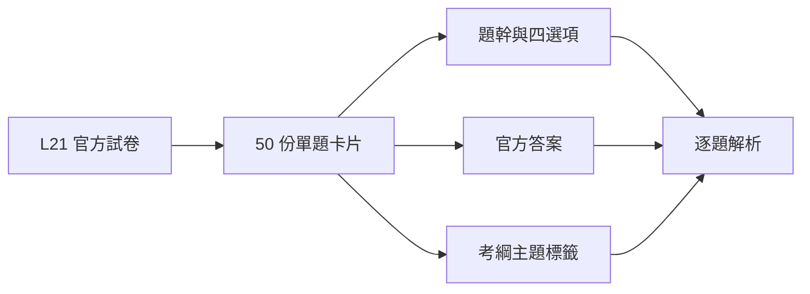

# 115 年第一次 L21 題目索引

科目：智慧製造生產與作業管理之實務應用

| 題號 | 官方答案 | 主題 | 來源頁 |
|---:|:---:|---|---:|
| [[Q01|Q01]] | A | MES、品質管理、資料分析、設備維護 | 1 |
| [[Q02|Q02]] | A | MES | 1 |
| [[Q03|Q03]] | C | 資料分析、感測器 | 1 |
| [[Q04|Q04]] | C | 精實管理、品質管理 | 1 |
| [[Q05|Q05]] | D | 資料分析 | 1 |
| [[Q06|Q06]] | C | 產能與線平衡 | 1 |
| [[Q07|Q07]] | C | 精實管理 | 2 |
| [[Q08|Q08]] | A | 精實管理 | 2 |
| [[Q09|Q09]] | B | 精實管理、產能與線平衡 | 2 |
| [[Q10|Q10]] | D | 其他 | 2 |
| [[Q11|Q11]] | C | 品質管理 | 2 |
| [[Q12|Q12]] | C | IoT與CPS、資料分析、工業通訊、雲端與邊緣 | 2 |
| [[Q13|Q13]] | A | IoT與CPS、雲端與邊緣 | 3 |
| [[Q14|Q14]] | C | 機器人 | 3 |
| [[Q15|Q15]] | D | 其他 | 3 |
| [[Q16|Q16]] | A | 資料分析 | 3 |
| [[Q17|Q17]] | B | MES | 3 |
| [[Q18|Q18]] | D | 生產排程 | 4 |
| [[Q19|Q19]] | D | 生產排程 | 4 |
| [[Q20|Q20]] | B | 品質管理、設備維護 | 4 |
| [[Q21|Q21]] | B | MES、生產排程 | 4 |
| [[Q22|Q22]] | D | 精實管理 | 4 |
| [[Q23|Q23]] | D | 其他 | 5 |
| [[Q24|Q24]] | D | 其他 | 5 |
| [[Q25|Q25]] | C | 生產排程 | 5 |
| [[Q26|Q26]] | C | MES、OEE與設備效率、資料分析、設備維護 | 5 |
| [[Q27|Q27]] | A | MES、生產排程 | 5 |
| [[Q28|Q28]] | C | 產能與線平衡、OEE與設備效率、品質管理、設備維護 | 5 |
| [[Q29|Q29]] | A | 其他 | 6 |
| [[Q30|Q30]] | B | 產能與線平衡 | 6 |
| [[Q31|Q31]] | D | 品質管理、設備維護 | 6 |
| [[Q32|Q32]] | D | 精實管理 | 6 |
| [[Q33|Q33]] | C | 其他 | 7 |
| [[Q34|Q34]] | D | 品質管理、資料分析 | 7 |
| [[Q35|Q35]] | D | 產能與線平衡、OEE與設備效率 | 7 |
| [[Q36|Q36]] | D | 精實管理 | 7 |
| [[Q37|Q37]] | D | 生產排程 | 7 |
| [[Q38|Q38]] | A | 其他 | 8 |
| [[Q39|Q39]] | C | 產能與線平衡 | 8 |
| [[Q40|Q40]] | C | 精實管理 | 8 |
| [[Q41|Q41]] | A | 產能與線平衡 | 8 |
| [[Q42|Q42]] | A | MES、資料分析、設備維護 | 8 |
| [[Q43|Q43]] | C | 其他 | 8 |
| [[Q44|Q44]] | C | 設備維護 | 8 |
| [[Q45|Q45]] | C | 產能與線平衡 | 9 |
| [[Q46|Q46]] | C | 品質管理、資料分析 | 9 |
| [[Q47|Q47]] | B | 品質管理、設備維護 | 9 |
| [[Q48|Q48]] | D | 精實管理、機器人 | 9 |
| [[Q49|Q49]] | D | 其他 | 9 |
| [[Q50|Q50]] | B | 資料分析 | 10 |

