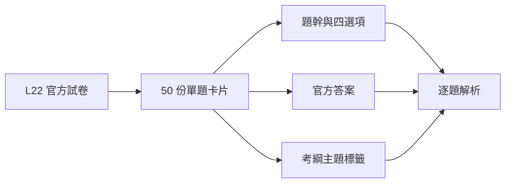

# 115 年第一次 L22 題目索引

科目：智慧製造之設備與製程管理之實務應用

| 題號 | 官方答案 | 主題 | 來源頁 |
|---:|:---:|---|---:|
| [[Q01|Q01]] | A | 機器視覺 | 1 |
| [[Q02|Q02]] | C | 機器視覺 | 1 |
| [[Q03|Q03]] | A | 其他 | 1 |
| [[Q04|Q04]] | B | IoT與CPS | 1 |
| [[Q05|Q05]] | D | 資料分析、工業通訊 | 1 |
| [[Q06|Q06]] | B | 機器視覺 | 1 |
| [[Q07|Q07]] | B | 機器人 | 2 |
| [[Q08|Q08]] | C | 其他 | 2 |
| [[Q09|Q09]] | A | 資料分析、設備維護 | 2 |
| [[Q10|Q10]] | D | 感測器 | 2 |
| [[Q11|Q11]] | A | 其他 | 2 |
| [[Q12|Q12]] | A | 資料分析 | 2 |
| [[Q13|Q13]] | B | 機器視覺 | 3 |
| [[Q14|Q14]] | A | 感測器 | 3 |
| [[Q15|Q15]] | D | IoT與CPS、資料分析、雲端與邊緣 | 3 |
| [[Q16|Q16]] | A | IoT與CPS、資料分析、設備維護 | 3 |
| [[Q17|Q17]] | C | 其他 | 3 |
| [[Q18|Q18]] | C | 產能與線平衡 | 3 |
| [[Q19|Q19]] | B | 產能與線平衡、品質管理 | 4 |
| [[Q20|Q20]] | C | IoT與CPS、感測器、工業通訊 | 4 |
| [[Q21|Q21]] | C | IoT與CPS、工業通訊 | 4 |
| [[Q22|Q22]] | B | 產能與線平衡、品質管理 | 4 |
| [[Q23|Q23]] | D | MES、品質管理、工業通訊 | 4 |
| [[Q24|Q24]] | A | 設備維護 | 5 |
| [[Q25|Q25]] | A | 資料分析 | 5 |
| [[Q26|Q26]] | C | 資料分析 | 5 |
| [[Q27|Q27]] | D | 機器視覺、機器人 | 5 |
| [[Q28|Q28]] | D | 機器視覺 | 5 |
| [[Q29|Q29]] | C | 機器人 | 5 |
| [[Q30|Q30]] | A | 其他 | 6 |
| [[Q31|Q31]] | C | 智慧控制、雲端與邊緣 | 6 |
| [[Q32|Q32]] | D | 機器人 | 6 |
| [[Q33|Q33]] | B | 智慧控制 | 6 |
| [[Q34|Q34]] | C | 智慧控制 | 6 |
| [[Q35|Q35]] | A | 雲端與邊緣 | 6 |
| [[Q36|Q36]] | B | 設備維護 | 7 |
| [[Q37|Q37]] | A | MES、生產排程、智慧控制 | 7 |
| [[Q38|Q38]] | A | 資料分析、感測器、雲端與邊緣 | 7 |
| [[Q39|Q39]] | A | 其他 | 7 |
| [[Q40|Q40]] | A | 產能與線平衡 | 7 |
| [[Q41|Q41]] | B | 其他 | 7 |
| [[Q42|Q42]] | B | 其他 | 8 |
| [[Q43|Q43]] | C | 設備維護 | 8 |
| [[Q44|Q44]] | A | 機器視覺、感測器 | 8 |
| [[Q45|Q45]] | A | 工業通訊 | 8 |
| [[Q46|Q46]] | C | 資料分析 | 8 |
| [[Q47|Q47]] | C | IoT與CPS | 8 |
| [[Q48|Q48]] | A | 精實管理、OEE與設備效率 | 9 |
| [[Q49|Q49]] | C | 產能與線平衡 | 9 |
| [[Q50|Q50]] | B | 設備維護 | 9 |

