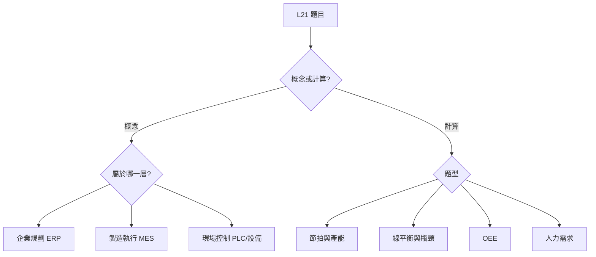

# L21 智慧製造生產與作業管理

## 官方考綱

### L211 智慧製造工廠管理實務與應用

- L21101 生產管理實務
- L21102 精實管理基本概念
- L21103 智慧工廠技術綜觀
- L21104 智慧化現場管理基本原理
- L21105 智慧製造執行系統生產實務

### L212 生產流程與產品品質優化

- L21201 MES 管控全廠資訊流與物流
- L21202 MES 與設備整合
- L21203 生產管理巨量資料
- L21204 生產排程優化
- L21205 生產線平衡與改善
- L21206 生產品質要因分析
- L21207 即時生產資訊收集與應用

## 高頻解題框架

## 必會主題

### MES 與智慧工廠

MES 負責把工單落實到製造現場，包括派工、工單狀態、設備與人員資料、在製品追蹤、品質、例外及績效。ERP 管企業資源與長中期規劃；PLC／SCADA 接近設備即時控制。常見陷阱是宣稱 MES 可完全取代 ERP，或能在沒有規則與人員監督下直接做所有決策。

### 精實管理

核心是價值流動與消除浪費。JIT、拉式生產、看板、標準作業、目視管理與持續改善相互配合。瓶頸與整體流動比單機 100% 稼動更重要。

### 排程與 TOC

瓶頸決定系統產出；瓶頸損失一小時等於全系統損失一小時。非瓶頸提前生產只會增加在製品。衡量排程要同時看交期、流程時間、在製品與資源閒置。

### 品質管理

品質應建立在設計與製程預防，不是生產完再全面檢查。FMEA 用嚴重度、發生度、偵測度評估風險；管制圖判斷製程是否受到特殊原因影響。

## 練習入口

- [[../../../03-歷屆試題/115-第一次-L21/00-題目索引|115 年第一次 L21 全 50 題]]
- [[../../../05-公式與圖解/公式總表|計算公式]]
- [[../../../05-公式與圖解/易混淆比較表|易混淆比較]]

