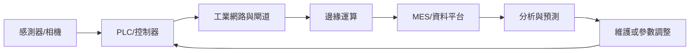

# L22 智慧製造設備與製程管理

## 官方考綱

### L221 智慧製造設備與製程管理

- L22101 物聯網基本原理
- L22102 CPS 基本原理
- L22103 自動設備管理與維護
- L22104 智慧製造設備管理與維護
- L22105 設備／製程巨量資料即時應用

### L222 智慧製造管控及介面知識

- L22201 感測器工業應用
- L22202 機器視覺工業應用
- L22203 機器人整合製造
- L22204 設備電腦化通訊
- L22205 智慧型控制
- L22206 管控介面管理與維護

### L223 智慧設備操作實務

- L22301 智慧製造設備操作知識
- L22302 稼動率、良率、效率指標

## 設備資料閉迴路

## 必會主題

### IoT 與 CPS

IoT 建立物件感知、識別、通訊與應用；CPS 在此基礎上加入運算與控制回饋，形成虛實整合閉迴路。5C 常見順序為 Connection、Conversion、Cyber、Cognition、Configuration。

### 設備維護

- 反應性：壞了再修，初期規劃少，但停機與連帶損失高。
- 預防性：按時間或使用量維護，容易執行，但可能過度保養。
- 預測性：依振動、溫度、電流等狀態與模型預測剩餘壽命。

### 機器視覺

先決定要看什麼特徵，再選相機、鏡頭、光源與演算法。背光適合輪廓；同軸光適合平整反光表面；偏振可抑制眩光或強化液體／透明材質差異。焦距、工作距離、視野、光圈與景深不可混用。

### 通訊與雲邊協同

MQTT QoS 為 0、1、2；RS-232 是串列介面；TCP/IP 需正確的 IP 與子網設定。高即時性、高資料量場景通常由邊緣先處理，再將結果送至平台。

## 練習入口

- [[../../../03-歷屆試題/115-第一次-L22/00-題目索引|115 年第一次 L22 全 50 題]]
- [[../../../05-公式與圖解/公式總表|計算公式]]
- [[../../../05-公式與圖解/易混淆比較表|易混淆比較]]

