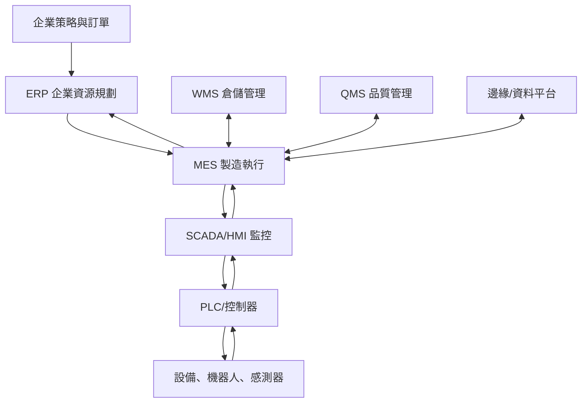

# 智慧工廠系統架構

| 層級 | 典型系統 | 時間尺度 | 主要任務 |
|---|---|---|---|
| 企業 | ERP | 天、週、月 | 訂單、財務、採購、主生產規劃 |
| 製造營運 | MES | 分鐘、班次、日 | 工單、派工、追蹤、品質、績效、例外 |
| 監控 | SCADA／HMI | 秒、分鐘 | 狀態監看、警報、歷史資料、人機操作 |
| 控制 | PLC／控制器 | 毫秒、秒 | 邏輯控制、連鎖、安全與動作 |
| 實體 | 設備／感測器 | 即時 | 加工、搬運、量測與回報 |

> [!tip] 判題技巧
> 問「長中期資源與財務」通常偏 ERP；問「工單到現場、WIP、追溯與績效」偏 MES；問「即時邏輯、I/O、馬達與閥」偏 PLC／控制層。

