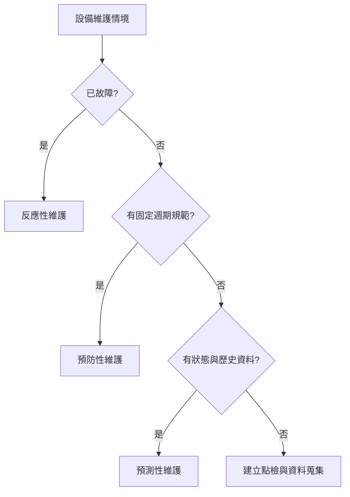

# 易混淆比較表

| 概念（中文名／英文全名／縮寫） | 定義 | 常見陷阱 |
|---|---|---|
| 節拍時間（Takt Time） | 可用時間／需求量 | 由市場需求決定，不是單機加工速度 |
| 週期時間（Cycle Time） | 完成一件或相鄰出件的實際週期 | 整線通常取瓶頸站時間 |
| 製程時間／加工時間（Process Time） | 工件實際被加工的時間 | 不一定包含等待、搬運與停滯 |
| 設計產能（Design Capacity） | 理論設計上限 | 用於利用率分母 |
| 有效產能（Effective Capacity） | 扣除正常限制後可達產能 | 用於效率分母 |
| 企業資源規劃（Enterprise Resource Planning, ERP） | 企業資源、財務、採購與規劃 | 不直接取代現場即時控制 |
| 製造執行系統（Manufacturing Execution System, MES） | 工單執行、WIP、追溯、品質與績效 | 不等於 ERP，也不是 PLC |
| 可程式邏輯控制器（Programmable Logic Controller, PLC） | 設備邏輯與即時 I/O 控制 | 不負責企業訂單與財務 |
| 物聯網（Internet of Things, IoT） | 物件感知、連線與資料服務 | 不必然包含閉迴路控制 |
| 網宇實體系統（Cyber-Physical Systems, CPS） | 運算、通訊、控制與實體閉迴路 | 不等於 ERP 或單一健康照護系統 |
| 預防性維修（Preventive Maintenance） | 依時間／用量排程 | 可能過度維護 |
| 預測性維修（Predictive Maintenance） | 依狀態資料預測失效 | 需要足夠資料與模型驗證 |
| 反應性維修（Reactive Maintenance） | 故障後修復 | 停機與連帶成本通常較高 |
| 效率（Efficiency） | 實際產出／有效產能 | 不要用設計產能作分母 |
| 利用率（Utilization） | 實際產出／設計產能 | 不要與設備可用率混為一談 |
| 推式生產（Push Production） | 依預測與計畫推入製程 | 容易累積 WIP |
| 拉式生產（Pull Production） | 後站需求觸發補充 | 看板與 JIT 常見此模式 |

## 維護策略選擇

