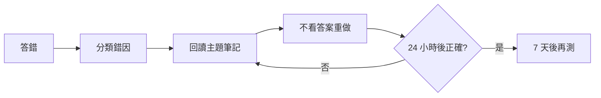

# L22 錯題本

## 錯題紀錄

| 日期 | 題目 ID | 我的答案 | 正解 | 錯因 | 主題 | 重做日期 | 已通過 |
|---|---|:---:|:---:|---|---|---|:---:|
|  |  |  |  | 觀念／公式／看錯題意／單位／計算 |  |  |  |

## 單題檢討模板

### 題目 ID

- 我的思路：
- 錯誤發生點：
- 正確判斷關鍵：
- 必背公式／定義：
- 24 小時後重做：
- 7 天後重做：

