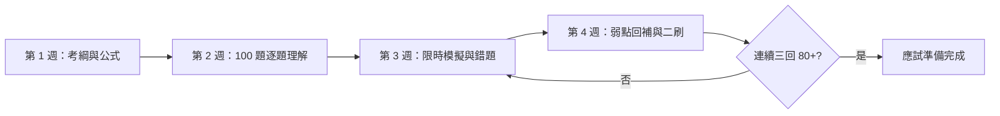

# 備考儀表板

## 模擬考紀錄

| 日期 | 科目 | 版本 | 分數 | 用時 | 概念錯 | 計算錯 | 粗心錯 |
|---|---|---|---:|---:|---:|---:|---:|
|  | L21 | A |  |  |  |  |  |
|  | L22 | A |  |  |  |  |  |

## 達標標準

- 每科 90 分鐘內完成。
- 每科至少 80 分。
- 兩科各連續三回達 80 分以上。
- 計算題須能寫出公式與單位，不只記答案。
- 疑義題須知道「官方答案」與「標準推導」的差異。

## 115 年題目主題標籤頻率

| 科目 | 主題 | 題數（可複選） |
|---|---|---:|
| L21 | 資料分析 | 10 |
| L21 | 品質管理 | 9 |
| L21 | 精實管理 | 9 |
| L21 | 其他 | 9 |
| L21 | 設備維護 | 8 |
| L21 | 產能與線平衡 | 8 |
| L21 | MES | 7 |
| L21 | 生產排程 | 6 |
| L21 | OEE與設備效率 | 3 |
| L21 | IoT與CPS | 2 |
| L21 | 雲端與邊緣 | 2 |
| L21 | 機器人 | 2 |
| L21 | 感測器 | 1 |
| L21 | 工業通訊 | 1 |
| L22 | 資料分析 | 9 |
| L22 | 其他 | 8 |
| L22 | 機器視覺 | 7 |
| L22 | IoT與CPS | 6 |
| L22 | 設備維護 | 6 |
| L22 | 工業通訊 | 5 |
| L22 | 感測器 | 5 |
| L22 | 產能與線平衡 | 5 |
| L22 | 機器人 | 4 |
| L22 | 雲端與邊緣 | 4 |
| L22 | 智慧控制 | 4 |
| L22 | 品質管理 | 3 |
| L22 | MES | 2 |
| L22 | 生產排程 | 1 |
| L22 | 精實管理 | 1 |
| L22 | OEE與設備效率 | 1 |

## 建議四週節奏

