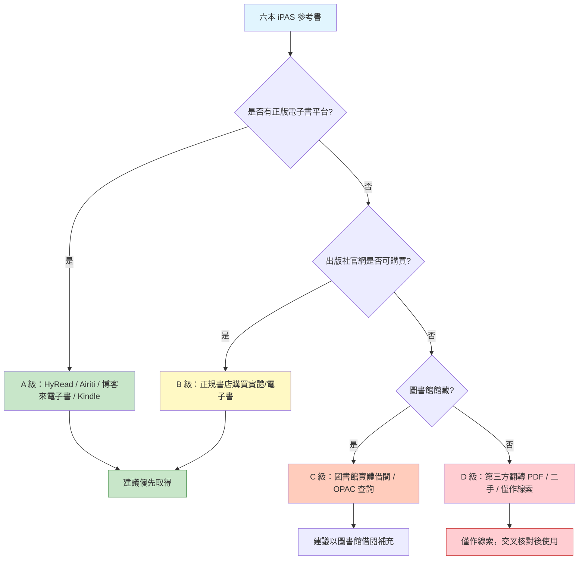

# iPAS 智慧生產工程師中級 - 圖書資源調查總覽

> 本檔彙整 iPAS 官方指定之 6 本參考書的網路取得途徑，包括 **PDF 電子檔**、**線上網站**、**書籍購買網站**，並依來源可信度與可取得性做詳細分析。
>
> 資料日期：2026-10-20（搜尋與驗證時間）

## 一、背景與說明

iPAS（Industry Professional Assessment System，產業專業人才能力鑑定）由經濟部產業發展署主辦、工研院產業學院執行。智慧生產工程師中級（L21 與 L22）的官方學習資源頁明確列出下列 6 本書為參考書目（註：僅供應考參考方向，非考試指定教科書）：

| # | 書名 | 出版社 | 作者/譯者 | 對應考科 | 主題歸屬 |
|---|------|--------|-----------|----------|----------|
| 1 | 作業管理 (Operations Management 12e) | 華泰文化 | Stevenson / 何應欽譯 | L21 | 生產與作業管理 |
| 2 | 工業4.0理論與實務 | 全華圖書 | 國立臺北科技大學 (2016) | L21/L22 | 工業4.0 總論 |
| 3 | 企業總合效率：工業4.0「智慧工廠」的基礎 | 白象文化 | 劉季旋、羅宇容 | L21 | 智慧工廠／績效 |
| 4 | 精實現場管理：豐田生產方式資深顧問親授40年現場管理實務 | 財團法人中衛發展中心 | 大野義男 | L21 | 精實生產／TPS |
| 5 | 從大數據到智慧生產與服務創新 | 前程文化 | 李傑、倪軍、王安正 | L21/L22 | 大數據／智慧生產 |
| 6 | 物聯網實作：工業4.0基礎篇 | 五南圖書 | 廖裕評、陸瑞強 | L21/L22 | IoT／工業4.0基礎 |

**官方來源**：iPAS 智慧生產工程師 > 學習資源 > 參考書目  
網址：https://ipd.nat.gov.tw/ipas/certification/SPE/learning-resources  
說明欄位註記：「僅提供考生作為應考之參考方向，非考試書籍」。

---

## 二、來源可信度分級 (參考專案既有規範)

| 等級 | 來源類型 | 用法建議 |
|------|----------|----------|
| **A** | iPAS 官方網站、出版社官網、正式電子書平台 (HyRead、Airiti 等)、圖書館館藏 | 優先採用，可作為解題原理與名詞定義的可靠依據 |
| **B** | 正規網路書店 (博客來、誠品、三民、睿瓏、華泰 eShop)、購買實體/電子書 | 可取得正版，適合自購研讀 |
| **C** | 圖書館 OPAC、大學課程講義、出版商試閱章節 | 僅作概念補充與預覽，不作為最終答案依據 |
| **D** | 第三方翻轉 PDF、Flipbook、分享平台 (Scribd、SlideShare 等)、二手市場 | 版權與完整性存疑，僅作線索，必須交叉核對，不建議作為唯一依據 |

---

## 三、六本書一覽與可取得性評估

| # | 書名 | 出版社 | ISBN | 正版電子書 | 線上購買 | 圖書館/OPAC | 第三方電子檔 | 可取得性評估 | 建議優先級 |
|---|------|--------|------|------------|----------|-------------|--------------|--------------|------------|
| 1 | 作業管理 (Operations Management 12e) | 華泰文化 | 9789863411796 | ❌ 未發現官方電子書 | ✅ 華泰 eShop、博客來、睿瓏 | ⚠️ 未查到公開館藏 | ⚠️ Scribd 講義、SlideShare 英文版 PDF | 中 | 高 (L21 核心) |
| 2 | 工業4.0理論與實務 | 全華圖書 | — | ❌ 未發現官方電子書 | ✅ 博客來、睿瓏、三民 | ✅ 台科大圖書館 OPAC | ❌ 未發現 | 中-high | 高 (工業4.0 總論) |
| 3 | 企業總合效率：工業4.0「智慧工廠」的基礎 | 白象文化 | 9789863584391 | ✅ 博客來電子書、HyRead、Amazon Kindle | ✅ 博客來、PChome Kobo | ⚠️ 未查到公開館藏 | ❌ 未發現 | 高 | 中 |
| 4 | 精實現場管理 | 中衛發展中心 | — | ❌ 未發現官方電子書 | ✅ 博客來、睿瓏 | ⚠️ 未查到公開館藏 | ⚠️ Flipbook (版權存疑) | 中 | 中 (L21 精實) |
| 5 | 從大數據到智慧生產與服務創新 | 前程文化 | 9789865774806 | ✅ 鼎隆圖書電子書 | ✅ 博客來、誠品、三民 | ✅ 雲科大圖書館館藏 | ❌ 未發現 | 中-high | 中 |
| 6 | 物聯網實作：工業4.0基礎篇 | 五南圖書 | 9789571192451 | ✅ Airiti 書城 (PDF 格式) | ✅ 博客來、誠品、momo、蝦皮 | ⚠️ 未查到公開館藏 | ❌ 未發現 | 高 | 中 (L22 IoT) |

**圖例**：✅ 有 / ❌ 無 / ⚠️ 部分或有爭議

---

## 四、取得建議與優先順序

### 建議購買/取得管道彙整

| 管道類型 | 網站 | 適用書籍 | 備註 |
|----------|------|----------|------|
| iPAS 官方 | https://ipd.nat.gov.tw/ipas/certification/SPE/learning-resources | 六本全 | 參考書目出處，非販售 |
| 華泰官網 eShop | https://eshop.hwatai.com.tw | #1 作業管理 | 出版社直營 |
| 博客來 | https://www.books.com.tw | #1 #2 #3 #4 #5 #6 | 台灣大型線上書店，#3 有電子書 |
| 誠品 | https://www.eslite.com | #5 #6 | 實體與線上 |
| 三民書局 | https://www.sanmin.com.tw | #2 #5 | 實體與線上 |
| 睿瓏網路書店 | https://www.megbook.com.tw / tenlong.com.tw | #1 #2 #4 | 專技書 |
| PChome 24h 書店 | https://24h.pchome.com.tw/books | #3 Kobo | 電子書 |
| 鼎隆圖書 eShop | https://eshop.tsanghai.com.tw | #5 電子書 | 前程文化電子書 |
| Airiti 書城 | https://www.airitibooks.com | #6 PDF 電子書 | 閱讀格式為 PDF |
| HyRead | https://tphcc.ebook.hyread.com.tw | #3 電子書 | 台北市立圖書館合作平台 |
| Amazon Kindle | https://www.amazon.com | #3 電子書 | 國際 Kindle 版 |
| 台科大圖書館 OPAC | https://holding.lib.ntut.edu.tw | #2 | 實體館藏查詢 |
| 雲科大圖書館 | https://www.lib.yuntech.edu.tw | #5 | 實體館藏查詢 |
| 中衛發展中心 | https://www.csd.org.tw | #4 | 出版社精實管理系列頁面 |

---

## 五、版權與使用注意事項

1. **非盜版原則**：僅列出可合法取得之管道。第三方翻轉 PDF (Scribd、SlideShare、Flipbook 等) 版權與完整性存疑，僅供參考線索，不建議下載作為正式研讀依據。
2. **官方聲明**：iPAS 學習資源頁註記參考書目「僅提供考生作為應考之參考方向，非考試書籍」，考試以官方公告試題與簡章為最終依據。
3. **ISBN 以搜尋結果為準**：部分舊版/新版 ISBN 可能不同，購買前請以出版社官網為準。
4. **電子書授權**：HyRead、Airiti、Kindle 等平台多為線上閱讀或有限期授權，非永久下載，購買前請確認授權條款。

---

## 六、各書詳細分析檔案

| 檔案 | 內容 |
|------|------|
| `01-作業管理-Stevenson-12e.md` | 作業管理 (Operations Management 12e) 詳細資源分析 |
| `02-工業4.0理論與實務.md` | 工業4.0理論與實務 詳細資源分析 |
| `03-企業總合效率-智慧工廠.md` | 企業總合效率：工業4.0「智慧工廠」的基礎 詳細資源分析 |
| `04-精實現場管理-大野義男.md` | 精實現場管理 詳細資源分析 |
| `05-從大數據到智慧生產與服務創新.md` | 從大數據到智慧生產與服務創新 詳細資源分析 |
| `06-物聯網實作-工業4.0基礎篇.md` | 物聯網實作：工業4.0基礎篇 詳細資源分析 |

---

> 本檔依 AGENTS.md 規範產出，採用 Markdown + Mermaid 格式，置於 `08-來源與勘誤/圖書資源調查/` 資料夾下。
