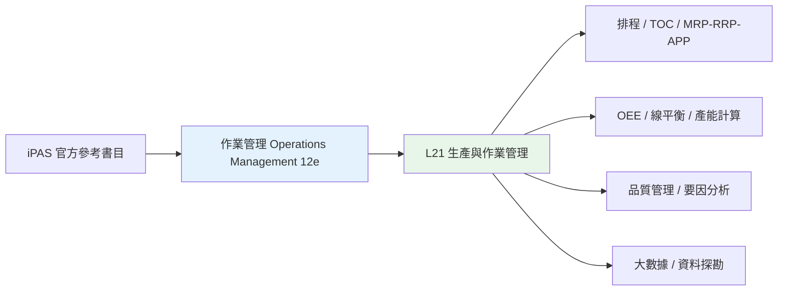
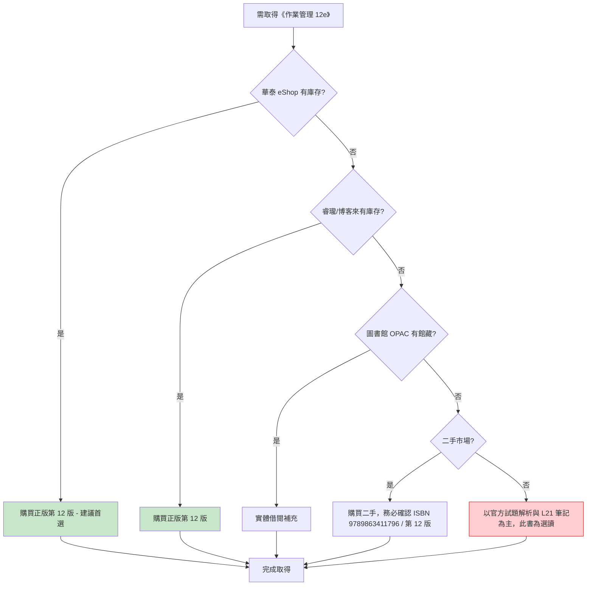

# 01 - 作業管理 (Operations Management 12e) - 圖書資源詳細分析

> 對應 iPAS 官方參考書目第 1 本，L21（智慧製造生產與作業管理之實務應用）的核心參考書。

---

## 一、書目基本資訊

| 項目 | 內容 |
|------|------|
| 書名 | 作業管理 (Operations Management 12e) |
| 原作者 | William J. Stevenson |
| 中文譯者 | 何應欽 |
| 出版社 | 華泰文化事業股份有限公司 |
| 版次 | 12 版 |
| 出版日期 | 2015/07/01 |
| ISBN | 9789863411796 |
| 適用課程 | 生產與作業管理 |
| iPAS 對應考科 | L21 第一科 |
| iPAS 對應主題 | 生產與作業管理、排程、TOC、MRP/RRP/APP、OEE、線平衡、品質管理 |
| 來源可信度 | B (出版社直營 eShop / 正規書店) |

---

## 二、iPAS 對應關係

L21 第一科考題涵蓋 MES、智慧工廠、IoT、精實生產、排程、TOC、MRP/RRP/APP、線平衡、OEE、品質管理、大數據等主軸。《作業管理 (Operations Management 12e)》涵蓋作業策略、專案管理、預測、產能規劃、排程、庫存、品質管控等，與 L21 的「生產與作業管理」範疇高度重疊，屬於解題原理與公式推導的 **B 級可靠依據**。

---

## 三、PDF 電子檔來源

| # | 來源平台 | 網址 | 類型 | 語言 | 完整性 | 版權評估 | 建議用途 |
|---|----------|------|------|------|--------|----------|----------|
| 1 | Scribd (朝陽科技大學資管系講義) | https://www.scribd.com/document/941200171/ | 第三方上傳講義 | 繁體中文 | 部分章節 | ⚠️ 版權存疑 | 僅作概念預覽線索 |
| 2 | SlideShare | https://www.slideshare.net/slideshow/operations-management-12th-edition-ebook-pdf/277336405 | 英文版 eBook PDF | 英文 | 疑似完整 | ⚠️ 版權存疑 | 僅作英文原書參考 |
| 3 | NDL (Ethiopia digital library) | https://ndl.ethernet.edu.et/bitstreams/03b452af-ebbb-4e14-93e9-397c949bc941/download | 英文版 PDF | 英文 | 不明 | ⚠️ 非中譯本 | 僅作英文原書參考 |

**結論**：目前 **未發現「作業管理 (Operations Management 12e) 何應欽譯」的官方正版電子書 PDF**。網路上可見的多為英文原書翻轉 PDF 或第三方課程講義，版權與完整性存疑，僅建議作為線索，不建議作為正式研讀依據。

---

## 四、線上網站

| # | 網站 | 網址 | 性質 | 備註 |
|---|------|------|------|------|
| 1 | iPAS 智慧生產工程師 - 學習資源 (參考書目) | https://ipd.nat.gov.tw/ipas/certification/SPE/learning-resources | 官方 | 確認此書為官方參考書目，非販售頁面 |
| 2 | 華泰文化 eShop | https://eshop.hwatai.com.tw/SalePage/Index/7005824 | 出版社官網 | 產品全稱、版次、作者、ISBN、適用課程皆詳列 |
| 3 | 睿瓏網路書店 (商品詳情) | https://www.megbook.com.tw/mall/detail.jsp?proID=2596270 | 正規書店 | 價 NT$ 820，出版社：華泰，出版日期 2015-07-01 |
| 4 | 博客來二手徵求頁 | https://www.taaze.tw/usedList.html?oid=11100811279 | 二手市場 | 出版日期 20150701，ISBN 9789863411796 |

---

## 五、書籍購買網站

| # | 購買平台 | 網址 | 狀態 | 參考價格 | 備註 |
|---|----------|------|------|----------|------|
| 1 | 華泰網路書店 eShop | https://eshop.hwatai.com.tw/SalePage/Index/7005824 | 出版社直營 | — | 最權威的版本來源 |
| 2 | 睿瓏網路書店 | https://www.megbook.com.tw/mall/detail.jsp?proID=2596270 | 正規書店 | NT$ 820 | 專技書籍通路 |
| 3 | 博客來 (二手徵求) | https://www.taaze.tw/usedList.html?oid=11100811279 | 二手 | — | 僅作參考，需確認版次與完整度 |
| 4 | 蝦皮二手 (13e) | https://shopee.tw/... | 二手 | — | 為第 13 版，非 12 版，購買前請注意版次 |

**建議**：優先至華泰官網 eShop 或睿瓏網路書店購買正版第 12 版；若需二手，務必確認 ISBN 9789863411796 與第 12 版。

---

## 六、可取得性評估與建議

| 項目 | 評估 |
|------|------|
| 正版電子書 PDF | ❌ 未發現官方電子書 |
| 實體書購買 | ✅ 可於華泰 eShop、睿瓏購買 |
| 圖書館館藏 | ⚠️ 未查到公開線上館藏 (建議再洽各大專圖書館 OPAC) |
| 第三方電子檔 | ⚠️ Scribd 講義、SlideShare 英文版，版權存疑 |
| 可取得性等級 | **中** |
| 建議優先級 | **高** (L21 核心參考書) |

---

## 七、結論

《作業管理 (Operations Management 12e) 何應欽譯》為 iPAS L21 的核心參考書，但 **目前未發現官方正版電子書 PDF**。建議採取「購買正版實體書為主、圖書館借閱為輔」的取得策略；網路上的 Scribd/SlideShare PDF 版權存疑，僅可作為輔助線索，不得作為正式解題依據。

---

> 本檔依 AGENTS.md 規範產出，採用 Markdown + Mermaid 格式，置於 `08-來源與勘誤/圖書資源調查/` 資料夾下。
