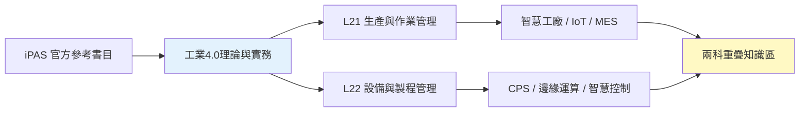
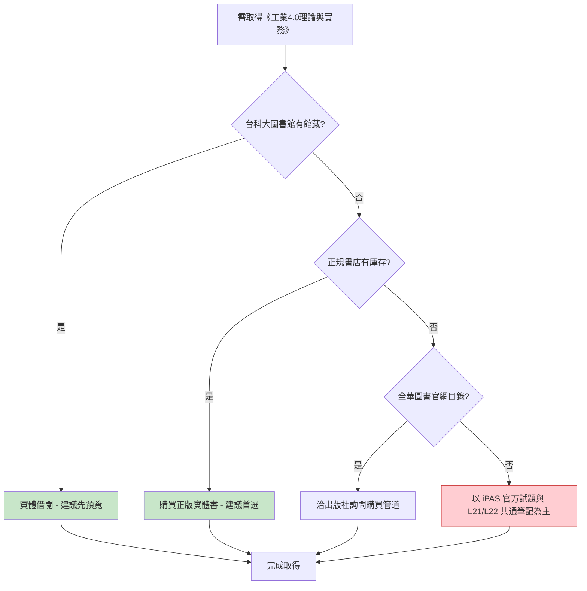

# 02 - 工業4.0理論與實務 - 圖書資源詳細分析

> 對應 iPAS 官方參考書目第 2 本，L21 與 L22 共通的工業4.0 總論參考書。

---

## 一、書目基本資訊

| 項目 | 內容 |
|------|------|
| 書名 | 工業4.0理論與實務 |
| 出版社 | 全華圖書 |
| 作者 | 國立臺北科技大學 (2016) |
| 版次 | — |
| 出版日期 | — |
| ISBN | — |
| iPAS 對應考科 | L21、L22 |
| iPAS 對應主題 | 工業4.0 總論、智慧製造、CPS、IoT、智慧工廠 |
| 備註 | 國內第一本「工業4.0」教學專書，內容含圖表超過百張，章節後附「問題與討論」 |
| 來源可信度 | B (正規書店 / 台科大圖書館 OPAC) |

---

## 二、iPAS 對應關係

本書為 iPAS L21 與 L22 兩科共通的工業4.0 基礎參考書，涵蓋智慧製造、CPS、IoT、智慧工廠等主題，與兩科重疊區（智慧工廠、MES、IoT、產能、線平衡、資料分析）高度相關，適合作為 **B 級可靠依據** 來理解工業4.0 的概念與架構。

---

## 三、PDF 電子檔來源

| # | 來源平台 | 網址 | 類型 | 語言 | 完整性 | 版權評估 | 建議用途 |
|---|----------|------|------|------|--------|----------|----------|
| 1 | — | — | — | — | — | — | 目前未發現公開電子書 PDF |

**結論**：目前 **未發現「工業4.0理論與實務」的官方正版電子書 PDF**。建議以實體書購買或圖書館借閱為主。

---

## 四、線上網站

| # | 網站 | 網址 | 性質 | 備註 |
|---|------|------|------|------|
| 1 | iPAS 智慧生產工程師 - 學習資源 (參考書目) | https://ipd.nat.gov.tw/ipas/certification/SPE/learning-resources | 官方 | 確認此書為官方參考書目 |
| 2 | 台科大圖書館 OPAC (館藏查詢) | https://holding.lib.ntut.edu.tw/bookDetail.do?id=447622 | 大學圖書館 | 國立臺北科技大學館藏，可查詢實體借閱狀態 |
| 3 | 全華大專教育資源網 | https://www.chwa.com.tw/newun/ | 出版社 | 全華圖書大專教育資源網，可查看相關教科書目錄 |
| 4 | 博客來 (商品詳情) | https://www.books.com.tw/products/0010815829 | 正規書店 | 本書為第一本工業4.0教學用專書，適合產業界培育人才 |
| 5 | 睿瓏網路書店 | https://www.tenlong.com.tw/products/9789865030407 | 正規書店 | ISBN 9789865030407，平裝 448 頁，23cm×17cm×2cm，650 克 |
| 6 | 三民書局 | https://www.sanmin.com.tw/product/index/007128196 | 正規書店 | 平裝 448 頁 |

---

## 五、書籍購買網站

| # | 購買平台 | 網址 | 狀態 | 參考價格 | 備註 |
|---|----------|------|------|----------|------|
| 1 | 博客來 | https://www.books.com.tw/products/0010815829 | 正規書店 | — | 台灣大型線上書店 |
| 2 | 睿瓏網路書店 | https://www.tenlong.com.tw/products/9789865030407 | 正規書店 | — | 專技書籍通路 |
| 3 | 三民書局 | https://www.sanmin.com.tw/product/index/007128196 | 正規書店 | — | 實體與線上購買 |
| 4 | 全華圖書官網 | https://www.chwa.com.tw/newun/ | 出版社 | — | 教科書目錄查詢 |

**建議**：優先至博客來、睿瓏或三民購買正版；若需先預覽，可洽台科大圖書館 OPAC 確認館藏後實體借閱。

---

## 六、可取得性評估與建議

| 項目 | 評估 |
|------|------|
| 正版電子書 PDF | ❌ 未發現官方電子書 |
| 實體書購買 | ✅ 可於博客來、睿瓏、三民購買 |
| 圖書館館藏 | ✅ 台科大圖書館有館藏 (holding.lib.ntut.edu.tw/id=447622) |
| 第三方電子檔 | ❌ 未發現 |
| 可取得性等級 | **中-high** |
| 建議優先級 | **高** (工業4.0 總論，兩科共通) |

---

## 七、結論

《工業4.0理論與實務》為 iPAS L21/L22 工業4.0 總論參考書，目前 **未發現官方正版電子書 PDF**，但 **台科大圖書館有實體館藏**，可先借閱預覽；購買則可至博客來、睿瓏、三民等正規書店。建議列為高優先級取得。

---

> 本檔依 AGENTS.md 規範產出，採用 Markdown + Mermaid 格式，置於 `08-來源與勘誤/圖書資源調查/` 資料夾下。
