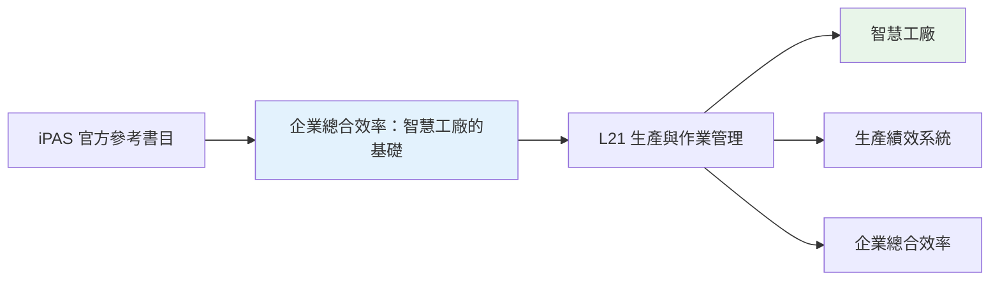
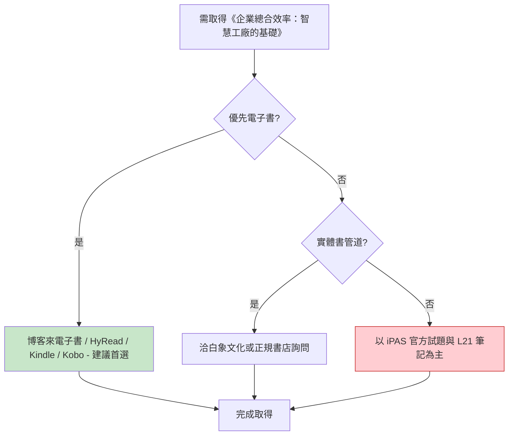

# 03 - 企業總合效率：工業4.0「智慧工廠」的基礎 - 圖書資源詳細分析

> 對應 iPAS 官方參考書目第 3 本，L21 的智慧工廠與企業績效參考書，且有多種正版電子書管道。

---

## 一、書目基本資訊

| 項目 | 內容 |
|------|------|
| 書名 | 企業總合效率：工業4.0「智慧工廠」的基礎 |
| 出版社 | 白象文化 |
| 作者 | 劉季旋、羅宇容 |
| 國立臺北科技大學 | (2016) 相關研究成果 |
| ISBN | 9789863584391 |
| 出版日期 | 2017/03/01 (實體)；2022/01/31 (電子書) |
| 頁數 | — |
| iPAS 對應考科 | L21 |
| iPAS 對應主題 | 企業總合效率、智慧工廠、生產績效、工業4.0 基礎 |
| 來源可信度 | A (有正版電子書平台：博客來電子書、HyRead、Amazon Kindle) |

---

## 二、iPAS 對應關係

本書聚焦「建立生產績效系統，降低成本、增強企業體質，順利邁向工業4.0」，為作者繼《生產績效管理》後的作品，適合產業界參考。與 L21 的智慧工廠、生產績效主題高度相關，屬於 **A 級可靠依據**。

---

## 三、PDF 電子檔來源

| # | 來源平台 | 網址 | 類型 | 語言 | 完整性 | 版權評估 | 建議用途 |
|---|----------|------|------|------|--------|----------|----------|
| 1 | 博客來電子書 | https://www.books.com.tw/products/E050121914 | 正式電子書 | 繁體中文 | 完整 | ✅ 正版 | 優先購買/線上閱讀 |
| 2 | HyRead 電子書 | https://tphcc.ebook.hyread.com.tw/bookDetail.jsp?id=147659 | 正式電子書 | 繁體中文 | 完整 | ✅ 正版 | 台北市立圖書館合作平台 |
| 3 | Amazon Kindle | https://www.amazon.com/-/es/劉季旋-ebook/dp/B09HK2HN29 | Kindle 電子書 | 繁體中文 | 完整 | ✅ 正版 | 國際 Kindle 版 |
| 4 | Kobo (PChome 24h) | https://24h.pchome.com.tw/books/prod/DJBQ04-D900DQ65W | Kobo 電子書 | 繁體中文 | 完整 | ✅ 正版 | PChome 書店 |

**結論**：本書有多種 **正版電子書管道**，是六本書中電子取得性最高的一本，建議優先以電子書形式取得。

---

## 四、線上網站

| # | 網站 | 網址 | 性質 | 備註 |
|---|------|------|------|------|
| 1 | iPAS 智慧生產工程師 - 學習資源 (參考書目) | https://ipd.nat.gov.tw/ipas/certification/SPE/learning-resources | 官方 | 確認此書為官方參考書目 |
| 2 | 博客來電子書 | https://www.books.com.tw/products/E050121914 | 正規書店電子書 | ISBN 9789863584391，出版社：白象文化，出版日期 2022/01/31 |
| 3 | HyRead 電子書 | https://tphcc.ebook.hyread.com.tw/bookDetail.jsp?id=147659 | 電子書平台 | 內容簡介：建立生產績效系統，順利邁向工業4.0 |
| 4 | Amazon Kindle | https://www.amazon.com/-/es/劉季旋-ebook/dp/B09HK2HN29 | 電子書平台 | 作者繼《生產績效管理》後之作品 |
| 5 | PChome 24h 書店 (Kobo) | https://24h.pchome.com.tw/books/prod/DJBQ04-D900DQ65W | 電子書平台 | ISBN 7288863584391，出版日期 2017/03/01 |
| 6 | Goodreads | https://www.goodreads.com/book/43067182-4-0/get_a_copy | 書目資訊 | 多平台購買連結彙整 |

---

## 五、書籍購買網站

| # | 購買平台 | 網址 | 狀態 | 參考價格 | 備註 |
|---|----------|------|------|----------|------|
| 1 | 博客來電子書 | https://www.books.com.tw/products/E050121914 | 正規書店 | — | 電子書，ISBN 9789863584391 |
| 2 | HyRead | https://tphcc.ebook.hyread.com.tw/bookDetail.jsp?id=147659 | 電子書平台 | — | 電子書，線上閱讀 |
| 3 | Amazon Kindle | https://www.amazon.com/-/es/劉季旋-ebook/dp/B09HK2HN29 | 電子書平台 | — | Kindle 電子書 |
| 4 | PChome 24h (Kobo) | https://24h.pchome.com.tw/books/prod/DJBQ04-D900DQ65W | 電子書平台 | — | Kobo 電子書 |

**建議**：優先購買博客來電子書或 HyRead 電子書，即時取得並可線上閱讀，適合備考期間快速檢索。

---

## 六、可取得性評估與建議

| 項目 | 評估 |
|------|------|
| 正版電子書 PDF / 電子書 | ✅ 博客來電子書、HyRead、Amazon Kindle、Kobo 均有 |
| 實體書購買 | ⚠️ 未查到主要正規書店實體販售頁 (以電子書為主) |
| 圖書館館藏 | ⚠️ 未查到公開線上館藏 |
| 第三方電子檔 | ❌ 未發現 |
| 可取得性等級 | **高** |
| 建議優先級 | **中** (電子書容易取得，可作為輔助參考) |

---

## 七、結論

《企業總合效率：工業4.0「智慧工廠」的基礎》為 iPAS L21 的智慧工廠與企業績效參考書，且 **有多種正版電子書管道** (博客來電子書、HyRead、Amazon Kindle、Kobo)，是六本書中電子取得性最高的一本。建議優先以電子書形式取得，適合備考期間快速檢索與閱讀。

---

> 本檔依 AGENTS.md 規範產出，採用 Markdown + Mermaid 格式，置於 `08-來源與勘誤/圖書資源調查/` 資料夾下。
