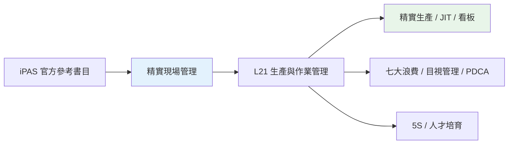
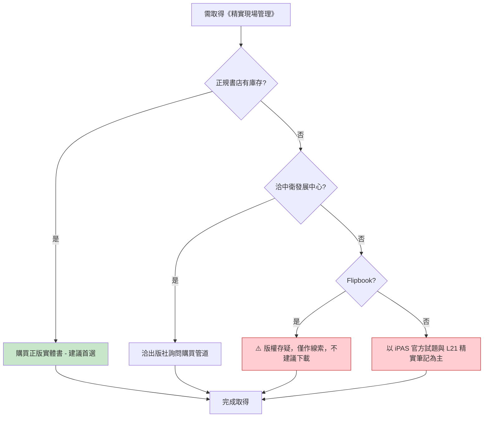

# 04 - 精實現場管理：豐田生產方式資深顧問親授40年現場管理實務 - 圖書資源詳細分析

> 對應 iPAS 官方參考書目第 4 本，L21 的精實生產／TPS 參考書，由財團法人中衛發展中心出版。

---

## 一、書目基本資訊

| 項目 | 內容 |
|------|------|
| 書名 | 精實現場管理：豐田生產方式資深顧問親授40年現場管理實務 |
| 出版社 | 財團法人中衛發展中心 |
| 作者 | 大野義男 (與江瑞坤) |
| 版次 | — |
| 出版日期 | — |
| ISBN | — |
| iPAS 對應考科 | L21 |
| iPAS 對應主題 | 精實生產、JIT、看板、七大浪費、目視管理、PDCA、5S、豐田生產方式 (TPS) |
| 備註 | 本書構築在豐田生產方式基礎下，深入說明精實工廠管理 Know-how 及企業理念、日常工廠管理重點活動、目視化與 5S 活動、人才培育 |
| 來源可信度 | B (出版社官網 / 正規書店) |

---

## 二、iPAS 對應關係

L21 第一科考題涵蓋精實生產、JIT、看板、七大浪費、目視管理與 PDCA 等主軸。本書由豐田生產方式資深顧問大野義男撰寫，內容涵蓋精實工廠管理 Know-how、目視化、5S、人才培育等，與 L21 精實生產主題高度相關，屬於 **B 級可靠依據**。

---

## 三、PDF 電子檔來源

| # | 來源平台 | 網址 | 類型 | 語言 | 完整性 | 版權評估 | 建議用途 |
|---|----------|------|------|------|--------|----------|----------|
| 1 | Flipbook (第三方) | https://online.flipbuilder.com/jackcck/glqw/ | 第三方翻轉 | 繁體中文 | 不明 | ⚠️ 版權存疑 | 僅作線索，不建議下載 |
| 2 | yabook.org (豐田生產方式，非本書) | https://yabook.org/post/16200.html | 第三方 PDF | 繁體中文 | — | ⚠️ 非本書，為大野耐一《豐田生產方式》 | 僅作相關概念參考 |

**結論**：目前 **未發現「精實現場管理」的官方正版電子書 PDF**。網路上僅有第三方 Flipbook，版權與完整性存疑，且該 Flipbook 來源不明，不建議下載作為正式研讀依據。另有 yabook.org 上的 PDF 為大野耐一《豐田生產方式》，非本書，僅可作為相關概念參考。

---

## 四、線上網站

| # | 網站 | 網址 | 性質 | 備註 |
|---|------|------|------|------|
| 1 | iPAS 智慧生產工程師 - 學習資源 (參考書目) | https://ipd.nat.gov.tw/ipas/certification/SPE/learning-resources | 官方 | 確認此書為官方參考書目 |
| 2 | 中衛發展中心 - 精實管理系列 | https://www.csd.org.tw/Publication?id=f5b851a9-b391-4884-90ea-b32e5f3f624e | 出版社官網 | 財團法人中衛發展中心精實管理系列出版頁面 |
| 3 | 博客來 (商品詳情) | https://www.books.com.tw/products/0010649728 | 正規書店 | 作者簡介：大野義男豐田生產方式管理專家，江瑞坤 TPS 實踐改善專家 |
| 4 | 睿瓏網路書店 | https://www.tenlong.com.tw/products/9789867690968 | 正規書店 | ISBN 9789867690968 |
| 5 | 豐田生產方式導論 (相關部落格) | https://shuohsuanli-bear.blogspot.com/2017/05/Lean-Management-08-TPS-Intro.html | 第三方 | 引用中衛發展中心 (Corporate...) 相關內容 |

---

## 五、書籍購買網站

| # | 購買平台 | 網址 | 狀態 | 參考價格 | 備註 |
|---|----------|------|------|----------|------|
| 1 | 博客來 | https://www.books.com.tw/products/0010649728 | 正規書店 | — | 台灣大型線上書店 |
| 2 | 睿瓏網路書店 | https://www.tenlong.com.tw/products/9789867690968 | 正規書店 | — | 專技書籍通路，ISBN 9789867690968 |
| 3 | 中衛發展中心官網 | https://www.csd.org.tw/Publication?id=f5b851a9-b391-4884-90ea-b32e5f3f624e | 出版社 | — | 可洽出版社詢問購買管道 |

**建議**：優先至博客來或睿瓏購買正版；如需了解出版背景，可洽中衛發展中心官網精實管理系列頁面。

---

## 六、可取得性評估與建議

| 項目 | 評估 |
|------|------|
| 正版電子書 PDF | ❌ 未發現官方電子書 |
| 實體書購買 | ✅ 可於博客來、睿瓏購買；可洽中衛發展中心 |
| 圖書館館藏 | ⚠️ 未查到公開線上館藏 |
| 第三方電子檔 | ⚠️ Flipbook 版權存疑，不建議下載 |
| 可取得性等級 | **中** |
| 建議優先級 | **中** (L21 精實主題，可作為輔助參考) |

---

## 七、結論

《精實現場管理：豐田生產方式資深顧問親授40年現場管理實務》為 iPAS L21 的精實生產／TPS 參考書，目前 **未發現官方正版電子書 PDF**，網路上僅有版權存疑的第三方 Flipbook，不建議下載。建議以購買正版實體書為主（博客來、睿瓏、中衛發展中心），或參考 iPAS 官方試題與 L21 精實筆記。

---

> 本檔依 AGENTS.md 規範產出，採用 Markdown + Mermaid 格式，置於 `08-來源與勘誤/圖書資源調查/` 資料夾下。
