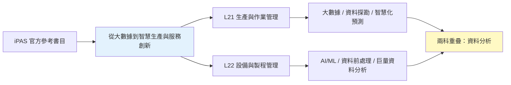
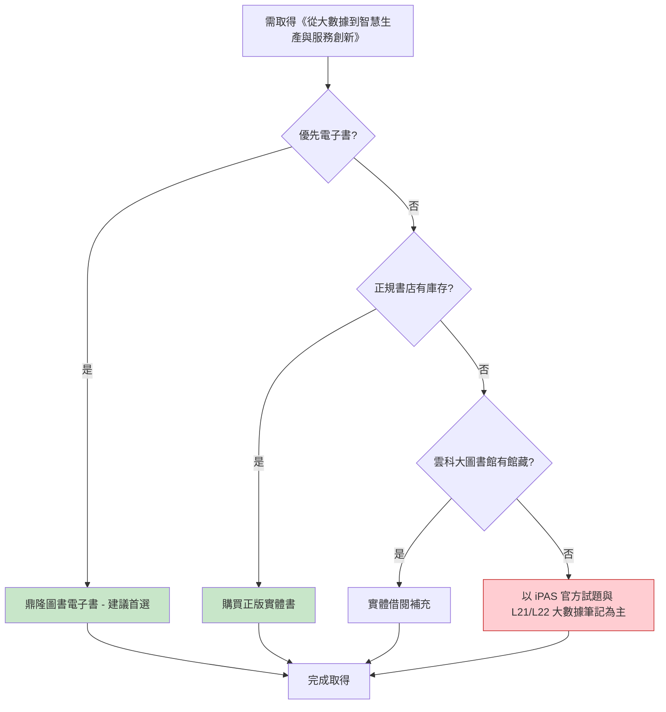

# 05 - 從大數據到智慧生產與服務創新 - 圖書資源詳細分析

> 對應 iPAS 官方參考書目第 5 本，L21 與 L22 的大數據／智慧生產參考書，由前程文化出版，有鼎隆圖書電子書管道。

---

## 一、書目基本資訊

| 項目 | 內容 |
|------|------|
| 書名 | 從大數據到智慧生產與服務創新 |
| 出版社 | 前程文化 |
| 作者 | 李傑、倪軍、王安正 (佘日新、廖宜椿、蔡璞、呂俊德等參與) |
| 原著 | 李傑、倪軍、王安正，《从大数据到智能制造》，上海交通大學出版社，2016，ISBN 7313149183 |
| ISBN (繁中版) | 9789865774806 |
| 頁數 | 252 頁 |
| 出版日期 | 2017 (台灣繁中版) |
| iPAS 對應考科 | L21、L22 |
| iPAS 對應主題 | 大數據、資料探勘、智慧化預測、智慧生產、AI/ML、工業4.0 轉型 |
| 備註 | 獨家收錄李傑教授與台灣智慧生產專家評析，分析各國推動工業4.0智慧生產轉型技術，強調台灣中小企業產業發展 |
| 來源可信度 | B (有鼎隆圖書電子書 / 正規書店 / 雲科大圖書館館藏) |

---

## 二、iPAS 對應關係

本書聚焦大數據推動智慧生產與服務創新，分析各國工業4.0 智慧生產轉型技術與發展趨勢，與 L21/L22 的大數據、資料探勘、智慧化預測、AI/ML 主題相關，屬於 **B 級可靠依據**，適合理解大數據與智慧生產的概念脈絡。

---

## 三、PDF 電子檔來源

| # | 來源平台 | 網址 | 類型 | 語言 | 完整性 | 版權評估 | 建議用途 |
|---|----------|------|------|------|--------|----------|----------|
| 1 | 鼎隆圖書 eShop | https://eshop.tsanghai.com.tw/products/VWIE0014 | 正式電子書 | 繁體中文 | 完整 | ✅ 正版 | 優先購買/線上閱讀 |

**結論**：本書有 **鼎隆圖書正式電子書管道**，可合法取得電子書。目前未發現公開的免費 PDF 電子檔。

---

## 四、線上網站

| # | 網站 | 網址 | 性質 | 備註 |
|---|------|------|------|------|
| 1 | iPAS 智慧生產工程師 - 學習資源 (參考書目) | https://ipd.nat.gov.tw/ipas/certification/SPE/learning-resources | 官方 | 確認此書為官方參考書目 |
| 2 | 博客來 (商品詳情) | https://www.books.com.tw/products/0010751826 | 正規書店 | ISBN 9789865774806，頁數 252，出版社：前程文化 |
| 3 | 鼎隆圖書 eShop (電子書) | https://eshop.tsanghai.com.tw/products/VWIE0014 | 電子書平台 | 前程文化電子書，獨家收錄李傑教授與台灣智慧生產專家評析 |
| 4 | 誠品 | https://www.eslite.com/product/1001164852593741 | 正規書店 | 實體與線上購買 |
| 5 | 三民書局 | https://www.sanmin.com.tw/product/index/006310102 | 正規書店 | 實體與線上購買 |
| 6 | 雲林科技大學圖書館 (館藏) | https://www.lib.yuntech.edu.tw/wSite/ct?xItem=9229&ctNode=4553&mp=2 | 大學圖書館 | 107年11月書目主題展，館藏「從大數據到智慧生產與服務創新」 |
| 7 | Facebook (李傑教授談本書) | https://www.facebook.com/fcmcEDU/videos/... | 媒體 | 前程文化粉專，作者介紹本書內容 |

---

## 五、書籍購買網站

| # | 購買平台 | 網址 | 狀態 | 參考價格 | 備註 |
|---|----------|------|------|----------|------|
| 1 | 鼎隆圖書 eShop (電子書) | https://eshop.tsanghai.com.tw/products/VWIE0014 | 電子書平台 | — | 前程文化電子書，建議首選 |
| 2 | 博客來 | https://www.books.com.tw/products/0010751826 | 正規書店 | — | 實體書購買 |
| 3 | 誠品 | https://www.eslite.com/product/1001164852593741 | 正規書店 | — | 實體書購買 |
| 4 | 三民書局 | https://www.sanmin.com.tw/product/index/006310102 | 正規書店 | — | 實體書購買 |

**建議**：優先購買鼎隆圖書電子書；實體書可至博客來、誠品、三民購買。如需先預覽，可洽雲科大圖書館確認館藏後實體借閱。

---

## 六、可取得性評估與建議

| 項目 | 評估 |
|------|------|
| 正版電子書 | ✅ 鼎隆圖書電子書 |
| 實體書購買 | ✅ 博客來、誠品、三民 |
| 圖書館館藏 | ✅ 雲科大圖書館有館藏 |
| 第三方電子檔 | ❌ 未發現 |
| 可取得性等級 | **中-high** |
| 建議優先級 | **中** (大數據/智慧生產主題，兩科共通) |

---

## 七、結論

《從大數據到智慧生產與服務創新》為 iPAS L21/L22 的大數據／智慧生產參考書，有 **鼎隆圖書正式電子書管道** 及 **雲科大圖書館館藏**，取得途徑相對多元。建議優先購買鼎隆圖書電子書，實體書可至博客來、誠品、三民購買。

---

> 本檔依 AGENTS.md 規範產出，採用 Markdown + Mermaid 格式，置於 `08-來源與勘誤/圖書資源調查/` 資料夾下。
