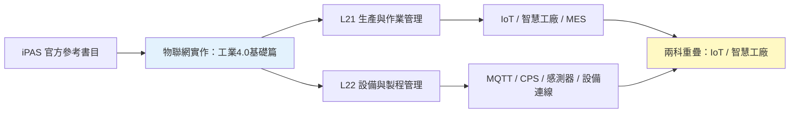
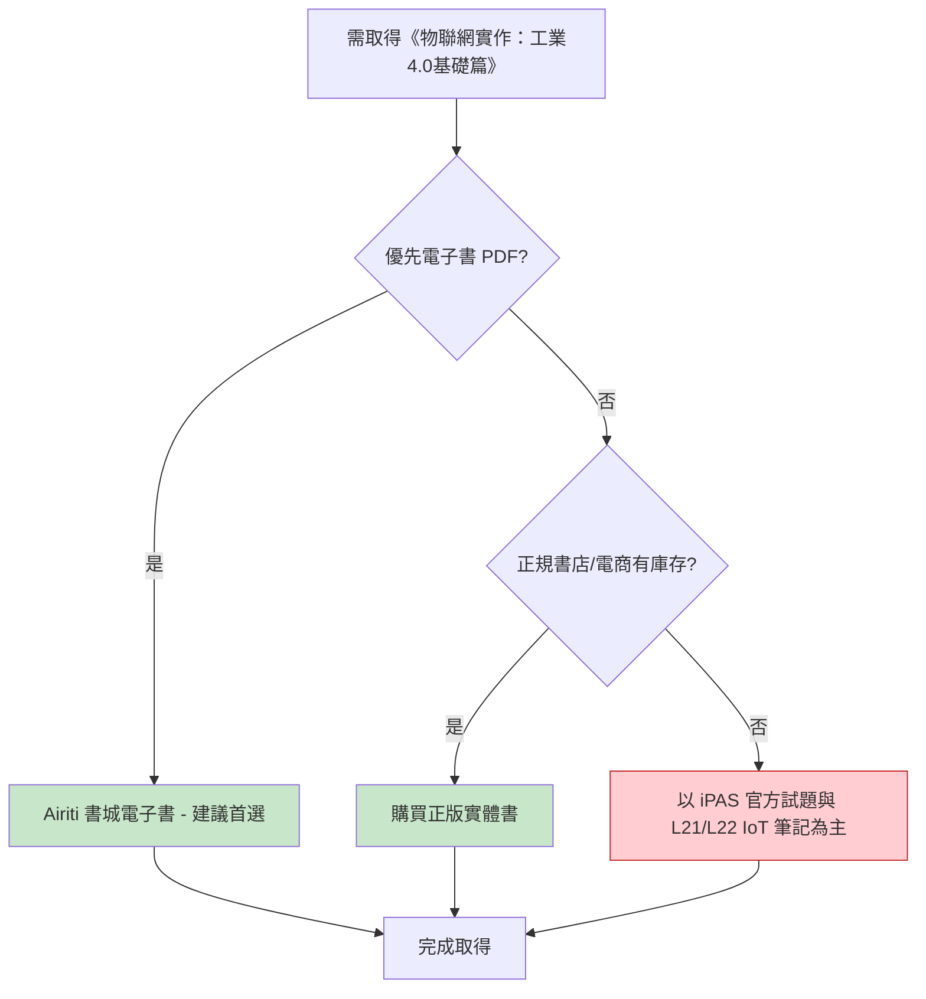

# 06 - 物聯網實作：工業4.0基礎篇 - 圖書資源詳細分析

> 對應 iPAS 官方參考書目第 6 本，L21 與 L22 的 IoT／工業4.0 基礎參考書，由五南圖書出版，且有 **Airiti 書城 PDF 電子書** 管道。

---

## 一、書目基本資訊

| 項目 | 內容 |
|------|------|
| 書名 | 物聯網實作：工業4.0基礎篇 |
| 出版社 | 五南圖書出版股份有限公司 |
| 作者 | 廖裕評、陸瑞強 |
| 版次 | 第 1 版 (2017/08/25)；第 2 版 (2018/10，附 CD) |
| ISBN | 9789571192451 |
| 頁數 | — |
| 定價 | NT$ 520 (第 2 版附 CD) |
| iPAS 對應考科 | L21、L22 |
| iPAS 對應主題 | IoT、MQTT、CPS、邊緣運算、感測器、機器視覺、設備連線、智慧工廠 |
| 備註 | 大學用書，附 CD，物聯網浪潮下產業與生活型態演進 |
| 來源可信度 | A (Airiti 書城有 PDF 電子書 / 正規書店) |

---

## 二、iPAS 對應關係

本書為工業4.0 基礎篇，涵蓋物聯網、MQTT、CPS、邊緣運算、感測器、機器視覺、設備連線等，與 L21 的 IoT/MES/智慧工廠 與 L22 的 IoT/MQTT/CPS/感測器/設備連線 主題高度重疊，屬於 **A 級可靠依據**，適合理解 IoT 與工業4.0 的基礎技術。

---

## 三、PDF 電子檔來源

| # | 來源平台 | 網址 | 類型 | 語言 | 完整性 | 版權評估 | 建議用途 |
|---|----------|------|------|------|--------|----------|----------|
| 1 | Airiti 書城 | https://www.airitibooks.com/Publication/Details?publicationID=P20181228159 | 正式電子書 | 繁體中文 | 完整 | ✅ 正版 | 優先購買/線上閱讀，閱讀格式為 PDF |

**結論**：本書有 **Airiti 書城正式電子書 (PDF 格式)** 管道，可合法取得電子書，是六本書中電子取得性較高的一本。

---

## 四、線上網站

| # | 網站 | 網址 | 性質 | 備註 |
|---|------|------|------|------|
| 1 | iPAS 智慧生產工程師 - 學習資源 (參考書目) | https://ipd.nat.gov.tw/ipas/certification/SPE/learning-resources | 官方 | 確認此書為官方參考書目 |
| 2 | Airiti 書城 (電子書 PDF) | https://www.airitibooks.com/Publication/Details?publicationID=P20181228159 | 電子書平台 | 作者：廖裕評、陸瑞強；出版社：五南；出版日期：2017/08/25；閱讀格式：PDF |
| 3 | 博客來 (商品詳情) | https://www.books.com.tw/products/0010764434 | 正規書店 | ISBN 9789571192451，出版日期 2017/08/25 |
| 4 | 誠品 | https://www.eslite.com/product/1001116712623003 | 正規書店 | 大學用書，物聯網實作基礎篇 |
| 5 | 五南圖書官網 | https://www.wunan.com.tw | 出版社 | 五南圖書，類似工業4.0 相關書籍 (如物聯網智慧應用與實務 NO=14048) |
| 6 | momo 購物網 | https://www.momoshop.com.tw/TP/TP0001679/goodsDetail/TP00016790011053 | 電商 | 五南出版大學用書【物聯網實作工業4.0基礎篇(附CD)】(2018年10月2版) |

---

## 五、書籍購買網站

| # | 購買平台 | 網址 | 狀態 | 參考價格 | 備註 |
|---|----------|------|------|----------|------|
| 1 | Airiti 書城 (電子書 PDF) | https://www.airitibooks.com/Publication/Details?publicationID=P20181228159 | 電子書平台 | — | 正式電子書，閱讀格式 PDF，建議首選 |
| 2 | 博客來 | https://www.books.com.tw/products/0010764434 | 正規書店 | — | 實體書購買，ISBN 9789571192451 |
| 3 | 誠品 | https://www.eslite.com/product/1001116712623003 | 正規書店 | — | 實體書購買 |
| 4 | momo 購物網 | https://www.momoshop.com.tw/TP/TP0001679/goodsDetail/TP00016790011053 | 電商 | — | 第 2 版附 CD |
| 5 | 蝦皮購物 | (搜尋結果) | 二手/電商 | NT$ 520 | 第 2 版附 CD，僅作參考 |
| 6 | Coupang | (搜尋結果) | 電商 | — | 五南出版物聯網實作工業4.0基礎篇 |
| 7 | biggo 比價 | https://biggo.com.tw/s/物聯網實作：工業4.0基礎篇/ | 比價網 | NT$ 452 | 大學書城 iOPEN Mall，僅供價格參考 |

**建議**：優先購買 Airiti 書城電子書 (PDF 格式)；實體書可至博客來、誠品、momo 購買。

---

## 六、可取得性評估與建議

| 項目 | 評估 |
|------|------|
| 正版電子書 PDF | ✅ Airiti 書城 |
| 實體書購買 | ✅ 博客來、誠品、momo、蝦皮 |
| 圖書館館藏 | ⚠️ 未查到公開線上館藏 |
| 第三方電子檔 | ❌ 未發現 |
| 可取得性等級 | **高** |
| 建議優先級 | **中** (IoT 基礎，兩科共通) |

---

## 七、結論

《物聯網實作：工業4.0基礎篇》為 iPAS L21/L22 的 IoT／工業4.0 基礎參考書，有 **Airiti 書城正式電子書 (PDF 格式)** 管道，且可於博客來、誠品、momo 等管道購買正版實體書，取得途徑相對多元。建議優先以 Airiti 書城電子書取得，適合備考期間快速檢索 IoT 與工業4.0 基礎概念。

---

> 本檔依 AGENTS.md 規範產出，採用 Markdown + Mermaid 格式，置於 `08-來源與勘誤/圖書資源調查/` 資料夾下。
