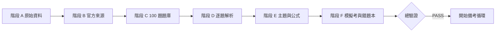

# 專案總驗證報告

- 題卡總數：100（預期 100）
- 已複核題卡：100（預期 100）
- 含解析題卡：100（預期 100）
- L21 模擬考：50 題
- L22 模擬考：50 題
- Markdown 文件：133 份
- 未成對程式碼／Mermaid fence：0
- 未成對 LaTeX 顯示公式界定符：0
- 六階段報告齊全：PASS

## 總結果：PASS

## 已知限制

1. 官方目前沒有在學習資源頁公開 108～114 年中級試題，因此不能宣稱已取得不存在或不可驗證的官方 PDF。
2. 115 L21 Q28 的公告答案與標準 OEE 推導不一致，已保留為疑義題。
3. 100 題概念題解析為第一版考點解析；後續可再依個人錯題加深每個干擾選項的專項說明。
