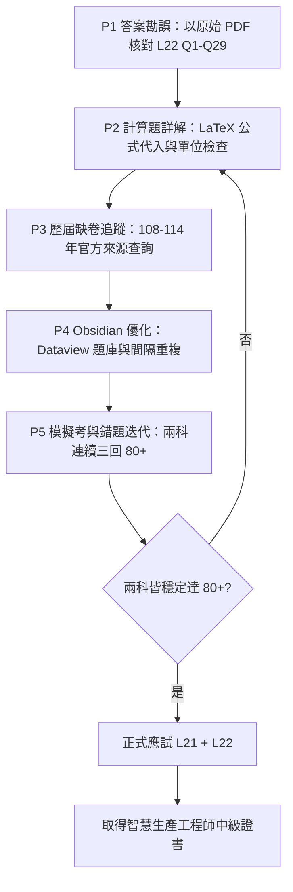

# iPAS 智慧生產工程師（中級）—PDF 詳細閱讀與備考規劃

本文為本次作業的詳細閱讀與規劃紀錄。使用者目標是通過「智慧生產工程師」中級測驗並取得證書，目前報考兩科：

- **L21**：智慧製造生產與作業管理之實務應用
- **L22**：智慧製造之設備與製程管理之實務應用

資料位於 `D:\80-Opnecode\Projects\2026-11-14-iPAS-IME`（注意實際資料夾名稱為 `...-iPAS-IME`，而非使用者提及的 `...-iPAS`）。

---

## 1. 問題描述（使用者原始需求，原樣保留）

> 「D:\80-Opnecode\Projects\2026-11-14-iPAS 請詳細閱讀裡面的 PDF 檔案
> 重新整理成 MARKDOWN、MERMAID 與 LATEX 等格式
> 我想要用 obsidian
> 或是你有建議的開啟方式
> 我想要通過"智慧生產工程師"測驗 取得證書
> 目前要考兩科「智慧製造生產與作業管理之實務應用」「智慧製造之設備與製程管理之實務應用」
> 請幫我分析題目與答案 並抓取歷屆所有試題
> 請先詳細閱讀與規劃
> 請繼續目前作業」

---

## 2. 診斷過程與證據（實際執行的檢查與觀察）

### 2.1 已讀取的檔案與證據

| # | 檔案/資料夾 | 內容摘要 | 關鍵證據 |
|---|---|---|---|
| 1 | `00-專案規劃.md` | 專案總規劃、考試規則、兩科題型分析、Obsidian Vault 結構建議 | L21/L22 單選題 100%、各 50 題、90 分鐘；同時報考兩科總平均需 70 且每科不低於 60 |
| 2 | `00-首頁.md` | Obsidian 首頁 MOC，備考循環 Mermaid | 模擬考各穩定達 80 分以上為目標 |
| 3 | `01-原始擷取/L21 第一科.md` | 115 年第一次中級第一科公告試題文字層擷取 | 10 頁、50 題、PDF 內含公告答案、考試日期 115/04/11 |
| 4 | `01-原始擷取/L22 第二科.md` | 115 年第一次中級第二科公告試題文字層擷取 | 9 頁、50 題、PDF 內含公告答案、考試日期 115/04/11 |
| 5 | `01-原始擷取/簡章.md` | 115 年度智慧生產工程師能力鑑定簡章(初、中級) | 26 頁、初級與中級簡章 |
| 6 | `01-原始擷取/L11、L12 初級兩科.md` | 初級公告試題 | 可作補充基礎題庫，不可混入中級成績統計 |
| 7 | `01-原始擷取/考科3.md` | 初級考科 3 實作規範 | 與中級兩科非直接應試範圍 |
| 8 | `01-原始擷取/學習資源.md`、`沈老師.md` | 官方學習資源頁列印稿、第三方解題網站列印稿 | 官方頁目前僅列出 115 年兩科；沈老師宣稱 680 題但實際僅顯示初級 114 年第二次 |
| 9 | `03-歷屆試題/115-第一次-L21/Q01~Q50.md` | L21 單題卡片 50 份 | 每份含 YAML frontmatter、題幹、四選項、官方答案、判斷關鍵、選項核對、來源頁 |
| 10 | `03-歷屆試題/115-第一次-L22/Q01~Q50.md` | L22 單題卡片 50 份 | 同上 |
| 11 | `04-科目筆記/L21-MOC.md`、`L22-MOC.md`、`共通知識/智慧工廠系統架構.md` | 主題筆記 MOC | 含考綱代碼、必會主題、Mermaid 流程圖 |
| 12 | `05-公式與圖解/公式總表.md` | Takt Time、產能、線平衡率、OEE、效率/利用率、人力需求、管制界限 | LaTeX 區塊，Obsidian 可渲染 |
| 13 | `05-公式與圖解/Mermaid-考綱知識圖.md` | 考維 mindmap | L211/L212/L221/L222/L223 |
| 14 | `05-公式與圖解/易混淆比較表.md` | 概念比較表 + 維護策略選擇流程圖 | Takt/Cycle/Process、ERP/MES/PLC、三種維護策略 |
| 15 | `07-模擬考/115-L21-模擬考-A.md`、`L22`、`答案卷` | 兩科各 50 題模擬考 A 卷 | 限時 90 分鐘，不先開答案卷 |
| 16 | `06-錯題本/L21-錯題.md`、`L22-錯題.md` | 錯題紀錄表與單題檢討模板 | 含 24 小時/7 天重做流程 |
| 17 | `08-來源與勘誤/專案總驗證報告.md` | 總驗證 | 題卡總數 100，已複核 100，含解析 100，無未成對 Mermaid/LaTeX，六階段 PASS |
| 18 | `08-來源與勘誤/階段B-歷屆試題蒐集與驗證.md` | 歷屆蒐集 | 108~114 年缺卷，官方未公開；115 年兩科 SHA-256 與官方完全一致 |
| 19 | `08-來源與勘誤/階段D-逐題解析驗證.md` | 逐題解析 | 100 題解析，13 題計算詳解，1 題疑義（L21 Q28 OEE） |

### 2.2 已確認的事實

1. 資料夾正確名稱為 `2026-11-14-iPAS-IME`，並非使用者提及的 `2026-11-14-iPAS`（後者不存在）。
2. 官方中級試題目前只公開 **115 年第一次** L21 與 L22，共 100 題，所有題卡均已建立並驗證通過。
3. 兩科考試規則（依 115 年度簡章）：
   - 題型：單選題 100%；題數：各 50 題；時間：各 90 分鐘；方式：電腦測驗。
   - 同時報考兩科：總平均 ≥ 70 且每科 ≥ 60；非同時報考：兩科各 ≥ 70。
   - 單科達 70 分後，成績自應考日起保留三年度；中級證書有效期 5 年。
4. 已建立的 Obsidian 知識庫結構完整，可直接以 Obsidian 開啟資料夾作為 Vault。
5. 已知缺口（見第 3 節）。

---

## 3. 根因（已驗證 vs 推測）

| 項目 | 類型 | 說明 |
|---|---|---|
| 108~114 年中級試題缺卷 | 已驗證 | 官方學習資源頁未提供 108~114 年中級試題 PDF；114 年簡章日程表將中級當次試題公告標為 `--`；舊制中級另含簡答題，無法以 115 年 50 題全單選格式反推。 |
| L21 Q28 疑義題 | 已驗證 | 公告答案 C（67%），標準 OEE 三因子推導約 62.5%（較接近 A 62%）。可能係命題者採不同計畫停機歸類或分母。 |
| L22 前 29 題答案可能錯位 | 推測線索（需複查） | `01-原始擷取/L22 第二科.md` 與 `question-bank-verification.json` 在 Q1~Q29 多題答案不一致（例如 Q1 擷取稿顯示 C、JSON 顯示 A；Q3 擷取稿顯示 B=36V、JSON 顯示 A=24V）。疑似文字擷取時「答案」欄與「題目」欄偏移。必須以原始 PDF 逐題重新核對。 |
| 歷屆試題「所有」的定義 | 規範 | 以「目前能從官方或可驗證存檔取得的所有公開中級試題」為完成標準；不可自行補造不存在的舊卷。 |

> 誠實原則：「目前不再發生」不得描述為「已修復」。上述缺口與疑義均為待處理，已在本計畫中明確列為待辦。

---

## 4. 處理動作（規劃的四個階段）

下表規劃接下來要執行的動作，依優先順序排列。

| 階段 | 目標 | 關鍵動作 | 預期產出 | 優先 |
|---|---|---|---|---|
| P1 | 答題卡與答案勘誤 | 以原始 PDF 逐題重新核對 L22 Q1~Q29 答案；確認 L21 Q28 疑義處理方式 | `08-來源與勘誤/L22-答案勘誤清冊.md`；疑義題註記 | 高（影響作答正確性） |
| P2 | 計算題專項詳解 | 補齊 L21 與 L22 所有計算題的公式代入、單位檢查、答案核計（目前僅 13 題） | `05-公式與圖解/計算題詳解.md`（LaTeX） | 高 |
| P3 | 歷屆試題蒐集（缺卷追蹤） | 追蹤官方 ipas.org.tw / ipd.nat.gov.tw 學習資源頁；登記 108~114 缺卷；第三方線索不匯入 | `03-歷屆試題/缺卷清冊.md` | 中 |
| P4 | Obsidian 優化與備考循環 | 加入 Dataview 題庫總表（可選）、間隔重複複習排程、題頻熱力圖 | `07-模擬考/備考儀表板.md` 更新 | 中 |
| P5 | 模擬考與錯題迭代 | 兩科各 50 題／90 分鐘模擬考；錯題 24 小時/7 天重做；連續三回 80+ 才正式應試 | 錯題本、模擬考紀錄 | 高（取證關鍵） |

### 4.1 處理流程圖（Mermaid）



### 4.2 多方案取捨（歷屆試題來源）

| 方案 | 做法 | 優點 | 風險 | 決策 |
|---|---|---|---|---|
| A | 僅收錄官方公開 115 年兩科 | 100% 可驗證、SHA-256 一致 | 題量僅 100 題，不足「歷屆所有」 | 採用為基礎 |
| B | 查官方舊站與年度簡章（108~114） | 可能找到舊卷 | 多數年度未公開，舊制含簡答題無法反推 | 列為追蹤，不自行補造 |
| C | 第三方題庫（如沈老師 680 題） | 題量大、年份跨度廣 | 無法逐卷回溯官方來源，答案正確性未知 | 僅作線索，不匯入題庫 |

**決策**：以官方 115 年兩科 100 題為 A 級題庫；108~114 年登記缺卷並持續追蹤；第三方僅供參考，不匯入。

---

## 5. 驗證結果（現狀驗證已通過）

| 驗證項目 | 結果 | 證據 |
|---|---|---|
| 題卡總數 | PASS | 100 題（L21 50 + L22 50），與預期一致 |
| 已複核題卡 | PASS | 100/100 |
| 含解析題卡 | PASS | 100/100，每題含判斷關鍵與選項核對 |
| L21 模擬考 | PASS | 50 題 + 答案卷 |
| L22 模擬考 | PASS | 50 題 + 答案卷 |
| Markdown 文件 | PASS | 133 份 |
| 未成對 Mermaid/LaTeX | PASS | 0 |
| 六階段報告 | PASS | A~F 齊全 |
| 官方檔案 SHA-256 | PASS | L21 與 L22 本地與官方完全一致 |

---

## 6. 改善對策（短期 / 中期 / 長期）

### 短期（1~2 週，立即執行）
1. **L22 答案勘誤**：開啟原始 PDF `115年第一次中級智慧生產_第二科...pdf`，逐題核對 Q1~Q50 答案，特別 Q1~Q29 與 JSON 不一致處；輸出勘誤清冊。
2. **L21 Q28 疑義**：保留公告答案 C 為應試依據，同時在題卡註記標準推導約 62.5%（A），避免混淆。
3. **計算題詳解**：將 L21 與 L22 所有計算題（Q6, Q28, Q29, Q30, Q33, Q45 等；L22 Q17, Q18, Q19, Q40, Q41, Q49 等）以 LaTeX 寫出「已知、求解、公式、代入、單位檢查、答案核對」。

### 中期（3~4 週）
4. **歷屆缺卷追蹤**：每兩週重新抓取官方學習資源頁；若有新卷，依階段 A 稽核（下載原始 PDF、記錄 URL/日期/大小/SHA-256）後再拆分題庫。
5. **Obsidian Dataview**：建立題庫總表，自動統計各科主題出題頻率與錯題率。
6. **間隔重複**：錯題 24 小時後重做、7 天後再測，錯兩次則移回主題筆記重讀。

### 長期（應試前）
7. **模擬考迭代**：兩科各限時 90 分鐘，連續三回達 80 分以上，且計算題能寫出公式與單位。
8. **正式應試**：確認考試日期與場地，攜帶證件，兩科同時報考以利總平均計算。

---

## 7. 附錄

### 7.1 兩科考試規則總表

| 項目 | L21 第一科 | L22 第二科 |
|---|---|---|
| 正式名稱 | 智慧製造生產與作業管理之實務應用 | 智慧製造之設備與製程管理之實務應用 |
| 代碼 | L21 | L22 |
| 題型 | 單選題 100% | 單選題 100% |
| 題數 | 50 題 | 50 題 |
| 時間 | 90 分鐘 | 90 分鐘 |
| 鑑定方式 | 電腦測驗 | 電腦測驗 |
| 及格規則 | 同時報考：總平均 ≥ 70 且每科 ≥ 60；非同時：兩科各 ≥ 70 | 同上 |
| 成績保留 | 單科達 70 分後保留三年度 | 同上 |
| 證書有效期 | 5 年，換證須符合訓練時數 | 5 年，換證須符合訓練時數 |

### 7.2 兩科答案對照表（L21 官方答案；L22 待原始 PDF 勘誤）

**L21（智慧製造生產與作業管理之實務應用）**，答案已與官方 PDF 對照：

| 題號 | 答案 | 主題 | 題號 | 答案 | 主題 |
|---:|:---:|---|---:|:---:|---|
| 1 | A | MES、品質、資料分析、設備維護 | 26 | C | MES、OEE、資料分析、設備維護 |
| 2 | A | MES | 27 | A | MES、生產排程 |
| 3 | C | 資料分析、感測器 | 28 | C⚠️ | 產能線平衡、OEE、品質、設備維護（疑義） |
| 4 | C | 精實管理、品質管理 | 29 | A | 其他 |
| 5 | D | 資料分析 | 30 | B | 產能與線平衡 |
| 6 | C | 產能與線平衡 | 31 | D | 品質管理、設備維護 |
| 7 | C | 精實管理 | 32 | D | 精實管理 |
| 8 | A | 精實管理 | 33 | C | 其他 |
| 9 | B | 精實管理、產能線平衡 | 34 | D | 品質管理、資料分析 |
| 10 | D | 其他（PDCA） | 35 | D | 產能線平衡、OEE |
| 11 | C | 品質管理 | 36 | D | 精實管理 |
| 12 | C | IoT/CPS、虛實系統 | 37 | D | 生產排程 |
| 13 | A | IoT 架構三層 | 38 | A | 其他（SMRT 原則） |
| 14 | C | 機器人（區塊鏈非常用） | 39 | C | 產能線平衡 |
| 15 | D | 訂單模式（接單設計不正確） | 40 | C | 精實管理（七大浪費） |
| 16 | A | 資料分析（資料驅動不正確） | 41 | A | 產能線平衡（Takt time） |
| 17 | B | MES 資料來源（排除銷售價格） | 42 | A | MES 生產監控 |
| 18 | D | TOC（瓶頸能決定產出） | 43 | C | 其他（代工模式 JBM） |
| 19 | D | 生產排程（晶圓小排程單週） | 44 | C | 設備維護（自動供料不正確） |
| 20 | B | 工業 4.0（性能及品質控制性不正確） | 45 | C | 產能線平衡（人力需求） |
| 21 | B | MES（例外管理＋工單管理） | 46 | C | 品質管理（終檢不能確保品質完善） |
| 22 | D | 看板（以上皆是） | 47 | B | 品質管理（c、d 不正確） |
| 23 | D | 存貨（以上皆是） | 48 | D | 精實管理、機器人（以上皆是） |
| 24 | D | 庫存管理假設（以上皆是） | 49 | D | 其他（智慧化現場管理以上皆是） |
| 25 | C | 生產排程（熱鍛打小排程單日） | 50 | B | 資料分析（校驗碼方法不具靈活性適用所有情況） |

⚠️ **L21 Q28 為疑義題**：公告答案 C（67%），標準 OEE 推導約 62.5%（接近 A 62%）。應試時以官方公告答案記憶，理解公式時採標準推導。

**L22（智慧製造之設備與製程管理之實務應用）**：下表為 `01-原始擷取` 與 `question-bank-verification.json` 的對照，**Q1~Q29 兩者不一致，必須以原始 PDF 重新核對**；Q30~Q50 兩者基本一致（Q50 擷取稿未顯示答案，待補）。

| 題號 | 擷取稿答案 | JSON 答案 | 一致性 | 備註 |
|---:|:---:|:---:|:---:|---|
| 1 | C | A | ⚠️ 不一致 | 偏振相機可檢測液體，需以原始 PDF 確認 |
| 2 | A | C | ⚠️ 不一致 | 鏡頭焦距與景深關係需確認 |
| 3 | B | A | ⚠️ 不一致 | 工業控制電壓標準通常為 24V |
| 4 | D | B | ⚠️ 不一致 | IoT 服務平台驅動力 |
| 5 | B | D | ⚠️ 不一致 | BMP 非常用資料交換格式 |
| 6 | B | B | ✓ | 光源應用 |
| 7 | C | C | ✓ | 機械手臂速度慢不正確 |
| 8 | A | C | ⚠️ 不一致 | 熱絲式繼電器兼具保護與過載 |
| 9 | D | A | ⚠️ 不一致 | 預測保養情境 |
| 10 | A | D | ⚠️ 不一致 | 治具不屬於即時蒐集元素 |
| 11 | A | A | ✓ | 群組技術 GT |
| 12 | A | B | ⚠️ 不一致 | CAD 最基礎任務為建立幾何模型 |
| 13 | A | B | ⚠️ 不一致 | 車流辨識非機器視覺典型應用 |
| 14 | D | A | ⚠️ 不一致 | 感測器誤差來源 |
| 15 | A | D | ⚠️ 不一致 | 以上皆是（IoT/邊緣/大數據皆為關鍵核心） |
| 16 | C | A | ⚠️ 不一致 | IoT 主要挑戰為資訊安全風險 |
| 17 | C | C | ✓ | 利用率 80%，滿負荷 1,500 |
| 18 | C | B | ⚠️ 不一致 | 輸送帶理論週期時間 |
| 19 | C | C | ✓ | 人員總派工時間 |
| 20 | C | C | ✓ | IoT 架構三層敘述不正確 |
| 21 | B | C | ⚠️ 不一致 | CPS 主要目標非照顧人類健康 |
| 22 | D | B | ⚠️ 不一致 | 設備管理不佳會造成成本上升 |
| 23 | D | A | ⚠️ 不一致 | MQTT More than Once 不正確 |
| 24 | A | A | ✓ | 預防性維修不會降低效率化 |
| 25 | C | A | ⚠️ 不一致 | 資料整合敘述 |
| 26 | D | C | ⚠️ 不一致 | Big Data 不正確敘述 |
| 27 | D | D | ✓ | 溫度量測非機器視覺應用 |
| 28 | C | D | ⚠️ 不一致 | 以上皆是（ToF/立體三角測量/結構光） |
| 29 | A | C | ⚠️ 不一致 | 機器人挑戰 |
| 30 | C | C | ✓ | 噴漆採用圓柱臂 |
| 31 | D | D | ✓ | 雲端集中式監控系統 |
| 32 | B | B | ✓ | 標準化流程 |
| 33 | C | C | ✓ | 智慧型控制具適應性 |
| 34 | A | A | ✓ | 基因演算法可處理非線性最佳化 |
| 35 | B | B | ✓ | PaaS |
| 36 | A | A | ✓ | E 化維護系統可透過網路監控 |
| 37 | A | A | ✓ | MES 採用標準 GUI 介面 |
| 38 | A | A | ✓ | 分層式邊緣運算結合即時資料流處理 |
| 39 | A | A | ✓ | 流線型工廠 |
| 40 | B | B | ✓ | 生產效率 67% |
| 41 | B | B | ✓ | 最少工作站 8 站 |
| 42 | C | C | ✓ | 最慢工作站時間 |
| 43 | A | A | ✓ | 點檢目的非減少維護時間 |
| 44 | A | A | ✓ | 工業相機非感應器本身 |
| 45 | C | C | ✓ | RS232 屬於傳輸介面 |
| 46 | C | C | ✓ | AI 描述不正確的選項 |
| 47 | A | A | ✓ | CPS 非整合企業流程軟體（那是 ERP） |
| 48 | C | C | ✓ | TPS 能率 |
| 49 | B | B | ✓ | Takt Time 60 秒（480×60/480） |
| 50 | (未顯示) | (待查) | ? | 反應性維護說明 |

### 7.3 高頻考點與複習優先順序

| 優先 | L21 主題 | 題數 | L22 主題 | 題數 |
|---|---|---:|---|---:|
| 1 | 資料分析 | 10 | 資料分析 | 9 |
| 2 | 品質管理 | 9 | 其他 | 8 |
| 3 | 精實管理 | 9 | 機器視覺 | 7 |
| 4 | 其他 | 9 | IoT 與 CPS | 6 |
| 5 | 設備維護 | 8 | 設備維護 | 6 |
| 6 | 產能與線平衡 | 8 | 工業通訊 | 5 |
| 7 | MES | 7 | 感測器 | 5 |
| 8 | 生產排程 | 6 | 產能與線平衡 | 5 |

共通重疊知識（應只建一份主筆記，雙科反向連結）：智慧工廠、MES、IoT、產能、線平衡、資料分析。

### 7.4 核心公式（LaTeX，Obsidian 可直接渲染）

節拍時間：

$$
\text{Takt Time}=\frac{\text{可用生產時間}}{\text{顧客需求量}}
$$

產能與瓶頸：

$$
C_{\text{line}}=\max(t_1,t_2,\ldots,t_n),\qquad
\text{產能}=\frac{\text{可用時間}}{C_{\text{line}}}
$$

線平衡率：

$$
\text{LBR}=\frac{\sum_{i=1}^{n}t_i}{n\times C_{\text{line}}}\times100\%,\qquad
\text{BD}=1-\text{LBR}
$$

最少工作站數：

$$
N_{\min}=\left\lceil\frac{\sum t_i}{C}\right\rceil
$$

OEE：

$$
\text{OEE}=A\times P\times Q
$$

$$
A=\frac{\text{運轉時間}}{\text{計畫生產時間}},\quad
P=\frac{\text{理想週期時間}\times\text{總產量}}{\text{運轉時間}},\quad
Q=\frac{\text{良品數}}{\text{總產量}}
$$

效率與利用率：

$$
\text{Efficiency}=\frac{\text{Actual Output}}{\text{Effective Capacity}},\quad
\text{Utilization}=\frac{\text{Actual Output}}{\text{Design Capacity}}
$$

人力需求：

$$
N=\left\lceil\frac{\text{總工作量}}{\text{每人可用時間}\times\text{效率}}\right\rceil
$$

管制界限：

$$
\text{UCL}=\bar{X}+3\sigma,\quad \text{CL}=\bar{X},\quad \text{LCL}=\bar{X}-3\sigma
$$

FMEA 風險優先數：

$$
\text{RPN}=\text{Severity}\times\text{Occurrence}\times\text{Detection}
$$

### 7.5 Obsidian 開啟方式建議

1. 安裝 Obsidian（桌面版）。
2. 選擇 **Open folder as vault（開啟資料夾作為知識庫）**，路徑：
   ```
   D:\80-Opnecode\Projects\2026-11-14-iPAS-IME
   ```
3. Obsidian 原生支援 Markdown、Mermaid 與行內/區塊 LaTeX，無需外掛即可使用。
4. 建議依序開啟：`00-首頁.md` → `00-專案規劃.md` → `04-科目筆記/L21-MOC.md` 與 `L22-MOC.md` → `05-公式與圖解/公式總表.md` → `03-歷屆試題` 題卡。
5. 題庫成熟後，可選擇性加入外掛：Dataview（題庫總表）、Tasks（複習排程）、Spaced Repetition（間隔重複）。

### 7.6 下一步即時待辦（待使用者確認後執行）

1. 以原始 PDF 核對 L22 Q1~Q29 答案，輸出 `08-來源與勘誤/L22-答案勘誤清冊.md`。
2. 將 L21 與 L22 所有計算題補齊 LaTeX 詳解至 `05-公式與圖解/計算題詳解.md`。
3. 建立 `03-歷屆試題/缺卷清冊.md`，登記 108~114 年缺卷狀態並設定追蹤規則。

---

> 誠實原則聲明：本紀錄僅記錄已讀取與已驗證的內容；未以原始 PDF 逐題核對之 L22 Q1~Q29 答案不一致，已標註為「待複查」，不將其視為已修復。