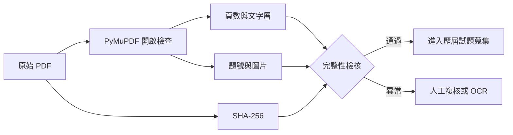

# 階段 A PDF 稽核清冊

> [!info] 方法
> 使用 PyMuPDF 1.28.2 重新開啟每份 PDF，獨立檢查頁數、加密狀態、文字層、內嵌圖片、題號與 SHA-256。原始 PDF 未被修改。

| 檔案 | 頁數 | 文字頁 | 文字字元 | 圖片 | 題號數 | 加密 | SHA-256 |
|---|---:|---:|---:|---:|---:|---|---|
| 115-01-初級智慧生產_L11_生產與作業管理基礎_公告試題_20260608113807.pdf | 10 | 10 | 8783 | 10 | 50 | 否 | `b89a737c31245de4cec15fea2cc974992f1ecc538b1c7621b5cf8ba1cd8509b4` |
| 115-01-初級智慧生產_L12_智慧製造生產線管理基礎_公告試題_20260608113824.pdf | 10 | 10 | 8369 | 10 | 50 | 否 | `4e83ec175c7694e67190d81ae9c773152a3c9e87b4b3d473734ab0b52c5f673a` |
| 115年度智慧生產工程師能力鑑定簡章(初、中級)_0410_20260410140735.pdf | 26 | 26 | 18773 | 33 | 6 | 否 | `4a6eec0d4507b3198097a886ff44ed0b92c3cd0522d1cd46c183b1ff0e2c87bb` |
| 115年第一次中級智慧生產_第一科_智慧製造生產與作業管理之實務應用_公告試題_20260729142554.pdf | 10 | 10 | 8471 | 10 | 50 | 否 | `6cd934d2920951691f7497003764cf7133e8f53cc830b04aef45084f792e62c2` |
| 115年第一次中級智慧生產_第二科_智慧製造之設備與製程管理之實務應用_公告試題_20260422152024.pdf | 9 | 9 | 7938 | 9 | 50 | 否 | `44d2f5a27a0ec9e5c8c592a130651d87a4c18d028bc9cc04c2dd484ba1d628ea` |
| 智慧生產工程師 - 學習資源.pdf | 2 | 2 | 1106 | 8 | 0 | 否 | `9dbfd6338bd23fcb57066783d4f3d382d905c9d5083e0bbecc50c67200071fe8` |
| 智慧生產工程師 - 沈老師的 iPAS 試題解答網.pdf | 1 | 1 | 453 | 0 | 0 | 否 | `77062df27da3398db0e0203f1f9ed627e20e6636a5a3ba917ad04cd68b640bbf` |
| 考科3_20251224152750.pdf | 10 | 10 | 2710 | 24 | 4 | 否 | `17ef02409e1fea1737ac2644a7e42fcdf6eab60fc90d3c61ba434f822d412633` |

## 驗證結果

- PDF 可直接開啟且未加密：PASS
- 每頁均具有可擷取文字層：PASS
- 已建立 SHA-256：PASS
- 檔案總數：8
- 總頁數：78

