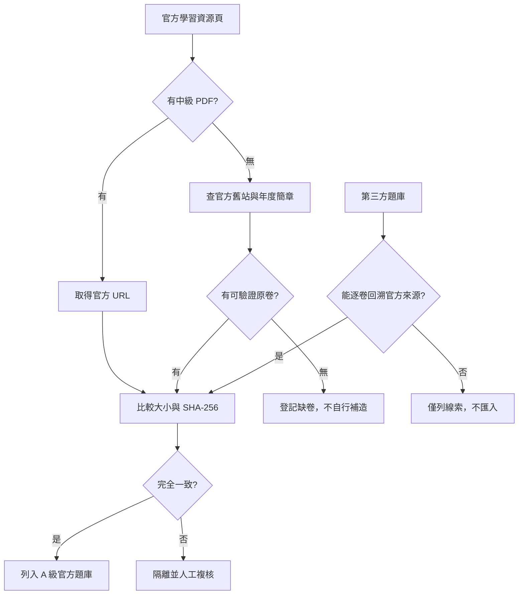

# 階段 B：歷屆試題蒐集與驗證

## 結論

截至 2026-10-19，iPAS 官方「智慧生產工程師－學習資源」頁面公開的中級試題只有：

1. 115 年第一次 L21「智慧製造生產與作業管理之實務應用」。
2. 115 年第一次 L22「智慧製造之設備與製程管理之實務應用」。

兩份檔案均已存在本專案，且本地檔案與官方下載內容的位元組數及 SHA-256 完全相同。因此，**目前可驗證、可公開取得的中級官方歷屆卷已完整收錄**。

108～114 年的簡章與政府成果文件可以證明當時曾辦理中級鑑定，但未在目前官方學習資源頁提供中級試題 PDF。114 年簡章的日程表亦把中級「當次試題公告」標為 `--`；舊制中級另含簡答題，不能用 115 年的 50 題全單選格式反推舊卷。

## 官方來源

- [智慧生產工程師－學習資源](https://ipd.nat.gov.tw/ipas/certification/SPE/learning-resources)
- [115 年 L21 官方 PDF](https://www.ipas.org.tw/api/proxy/uploads/certification_resource/4ee7f4184b654a3495f586fc869054fd/115%E5%B9%B4%E7%AC%AC%E4%B8%80%E6%AC%A1%E4%B8%AD%E7%B4%9A%E6%99%BA%E6%85%A7%E7%94%9F%E7%94%A2_%E7%AC%AC%E4%B8%80%E7%A7%91_%E6%99%BA%E6%85%A7%E8%A3%BD%E9%80%A0%E7%94%9F%E7%94%A2%E8%88%87%E4%BD%9C%E6%A5%AD%E7%AE%A1%E7%90%86%E4%B9%8B%E5%AF%A6%E5%8B%99%E6%87%89%E7%94%A8_%E5%85%AC%E5%91%8A%E8%A9%A6%E9%A1%8C_20260729142554.pdf)
- [115 年 L22 官方 PDF](https://www.ipas.org.tw/api/proxy/uploads/certification_resource/4ee7f4184b654a3495f586fc869054fd/115%E5%B9%B4%E7%AC%AC%E4%B8%80%E6%AC%A1%E4%B8%AD%E7%B4%9A%E6%99%BA%E6%85%A7%E7%94%9F%E7%94%A2_%E7%AC%AC%E4%BA%8C%E7%A7%91_%E6%99%BA%E6%85%A7%E8%A3%BD%E9%80%A0%E4%B9%8B%E8%A8%AD%E5%82%99%E8%88%87%E8%A3%BD%E7%A8%8B%E7%AE%A1%E7%90%86%E4%B9%8B%E5%AF%A6%E5%8B%99%E6%87%89%E7%94%A8_%E5%85%AC%E5%91%8A%E8%A9%A6%E9%A1%8C_20260422152024.pdf)

## 覆蓋清冊

| 年度 | 中級鑑定證據 | 官方中級試題公開狀態 | 本專案狀態 | 信賴等級 |
|---:|---|---|---|---|
| 108 | 年度簡章可查 | 現行官方頁未提供 | 缺卷，列入追蹤 | B |
| 109 | 歷年制度資料可查 | 現行官方頁未提供 | 缺卷，列入追蹤 | B |
| 110 | 簡章與政府成果報告可查 | 現行官方頁未提供 | 缺卷，列入追蹤 | B |
| 111 | 官方舊站簡章可查 | 現行官方頁未提供 | 缺卷，列入追蹤 | A/B |
| 112 | 歷年制度資料可查 | 現行官方頁未提供 | 缺卷，列入追蹤 | B |
| 113 | 歷年制度資料可查 | 現行官方頁未提供 | 缺卷，列入追蹤 | B |
| 114 | 官方簡章可查；中級當次試題公告標為 `--` | 未公告／目前無公開卷 | 不以第三方重建冒充官方卷 | A |
| 115 | 官方學習資源頁 | L21、L22 均公開 | 已完整收錄 | A |

## 第三方來源稽核

「沈老師的 iPAS 試題解答網」首頁宣稱智慧生產工程師收錄 680 題及涵蓋 108～113 年，但實際智慧生產分類頁目前只顯示 114 年第二次**初級**兩科，沒有可供驗證的中級歷屆卷清單。因此：

- 可當作可能存在舊題資料的線索。
- 不列入官方題庫。
- 不將其題目或答案自動匯入。
- 若未來取得逐卷來源與官方對照，才可降級標為「第三方重建題」。

## 官方檔案一致性驗證

| 檔案 | 官方 Content-Type | 官方大小 | 本地大小 | SHA-256 | 結果 |
|---|---|---:|---:|---|---|
| 115 L21 | `application/pdf` | 443,422 | 443,422 | `6cd934d2920951691f7497003764cf7133e8f53cc830b04aef45084f792e62c2` | PASS |
| 115 L22 | `application/pdf` | 389,426 | 389,426 | `44d2f5a27a0ec9e5c8c592a130651d87a4c18d028bc9cc04c2dd484ba1d628ea` | PASS |

完整機器驗證結果見：`official-source-verification.json`。

## 蒐集與判定流程

## 階段驗證

- 官方現行學習資源頁已重新抓取：PASS
- 官方頁所列兩份中級 PDF 已收錄：PASS
- 本地與官方檔案 SHA-256 一致：PASS
- 108～114 缺卷狀態已明確記錄：PASS
- 未把第三方宣稱誤當官方完整性證據：PASS

## 後續追蹤規則

若官方新增或恢復舊卷，應：

1. 下載原始 PDF。
2. 記錄公告頁、下載 URL、日期、檔案大小與 SHA-256。
3. 先通過階段 A 稽核，再進入題庫拆分。
4. 不覆蓋既有檔案；使用年度、梯次與科目建立唯一識別碼。

