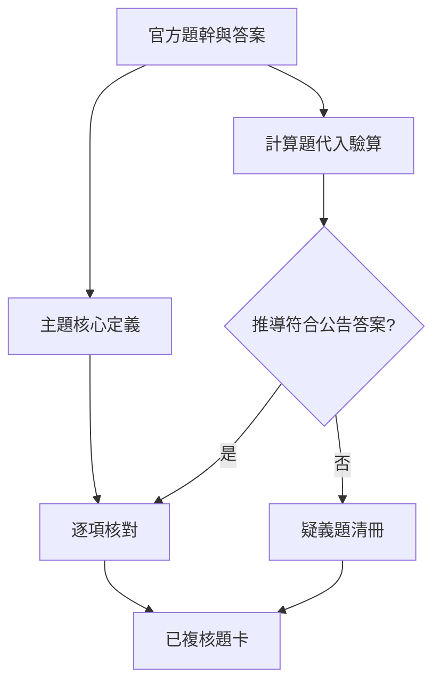

# 階段 D：逐題解析驗證

- 已產生解析：100 題
- 題庫結構前置驗證：PASS
- 具有官方答案：PASS
- 具有判斷關鍵：PASS
- 具有選項核對表：PASS
- 公式／計算專題詳解：13 題
- 公告答案與標準推導衝突：1 題（115-1-L21-Q28）

> [!warning] 驗證範圍
> `verified: true` 表示題幹、選項與公告答案已能回溯官方 PDF，且解析卡格式完整；不代表官方答案永遠無疑義。Q28 已保留相反的標準公式推導並標示 REVIEW。

## 疑義題

### 115-1-L21-Q28

公告答案為 C（67%），依標準 OEE 三因子及題目給定停機時間推導約為 62.5%，較接近 A（62%）。可能原因是命題者採用不同的計畫停機歸類或分母。本題不可刪除差異；正式考試若遇原題，以官方公告答案記憶，但理解標準公式時應使用 62.5% 推導。
