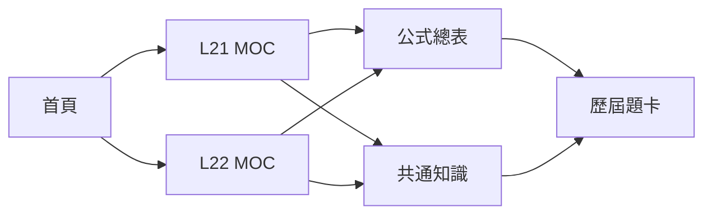

# 階段 E：主題筆記與圖解驗證

| 檔案 | Wikilinks | 斷鏈 | Mermaid | Code fence | LaTeX 區塊 |
|---|---:|---:|---:|:---:|:---:|
| 00-首頁.md | 10 | 0 | 1 | PASS | PASS |
| 04-科目筆記\L21-生產與作業管理\00-L21-MOC.md | 3 | 0 | 1 | PASS | PASS |
| 04-科目筆記\L22-設備與製程管理\00-L22-MOC.md | 3 | 0 | 1 | PASS | PASS |
| 04-科目筆記\共通知識\智慧工廠系統架構.md | 0 | 0 | 1 | PASS | PASS |
| 05-公式與圖解\公式總表.md | 0 | 0 | 0 | PASS | PASS |
| 05-公式與圖解\易混淆比較表.md | 0 | 0 | 1 | PASS | PASS |
| 05-公式與圖解\Mermaid-考綱知識圖.md | 0 | 0 | 1 | PASS | PASS |

**階段結果：PASS**

